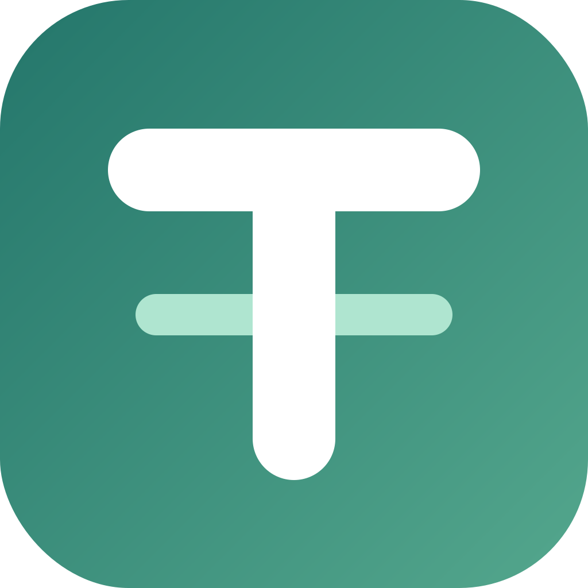
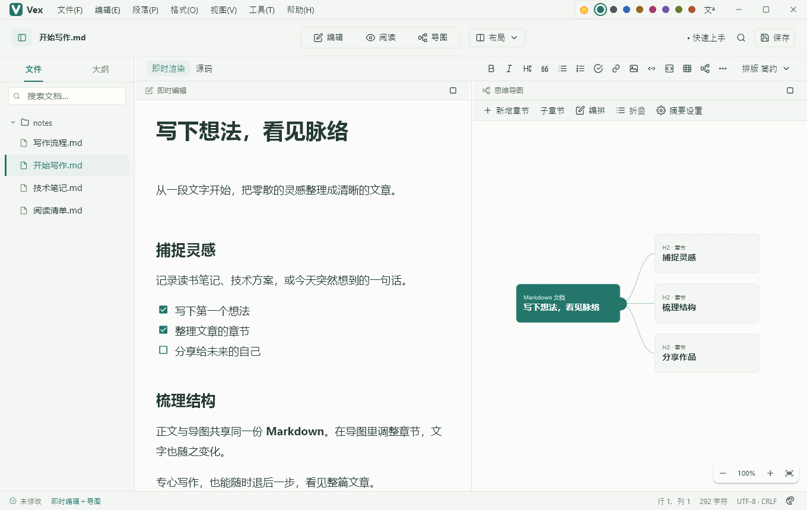
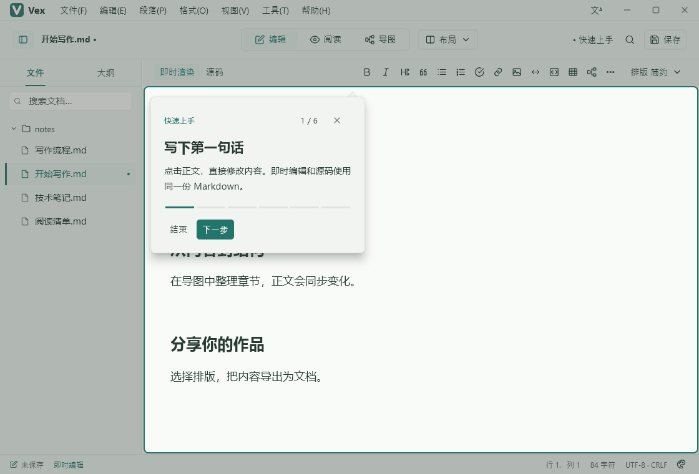
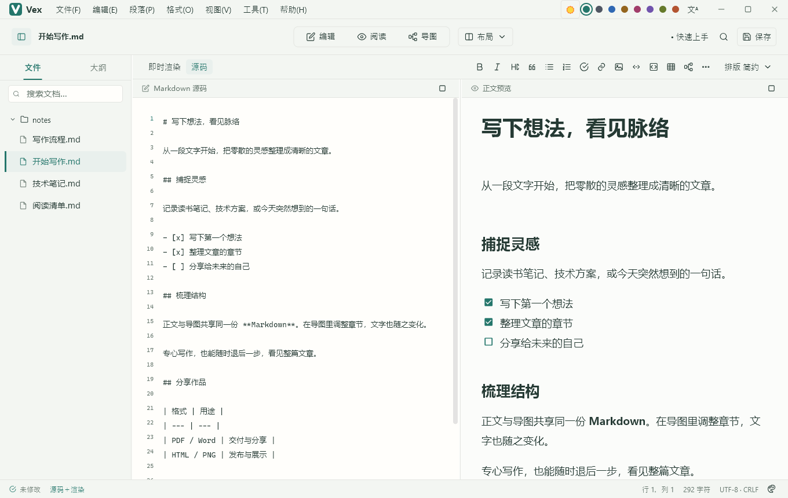
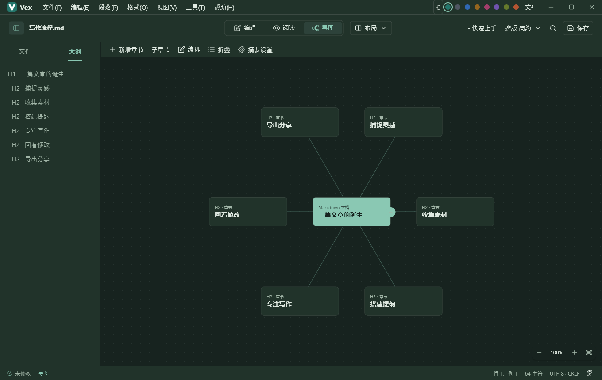

<p align="center">
  
</p>

<h1 align="center">维刻 Vex</h1>

<p align="center"><strong>写下想法，看见脉络</strong></p>

<p align="center">本地优先的开源 Markdown 写作空间。<br>写文章、理结构、看导图，在同一份文档里完成。</p>

<p align="center">
  <a href="https://github.com/dotnet9/Vex-Flutter/releases/latest"></a>
  <a href="https://github.com/dotnet9/Vex-Flutter/actions/workflows/ci.yml"></a>
  <a href=".flutter-version"></a>
  <a href="LICENSE"></a>
</p>

<p align="center">
  <a href="https://github.com/dotnet9/Vex-Flutter/releases"><strong>下载安装包</strong></a> ·
  <a href="#先看一遍新手引导">观看引导</a> ·
  <a href="#值得试试的功能">特色功能</a> ·
  <a href="https://github.com/dotnet9/Vex-Flutter/issues/new/choose">反馈与建议</a>
</p>



**不是把笔记关进另一个数据库，而是让你的 Markdown 文件多一种打开方式。**

Vex 适合整理技术笔记、读书记录、长文提纲和项目方案。像熟悉的 Markdown 编辑器一样写作，也能随时切到导图，从整篇文章的结构重新思考。

> 当前为 0.x 早期项目。下方截图与 GIF 均采集自 Windows 原生 Flutter 应用，不是网页原型；公开安装包对应各自的发布标签，界面和功能可能与开发分支有差异。

## 先看一遍新手引导

不必先 clone 仓库，先用半分钟看看 Vex 的工作方式：**即时写作 → 源码与预览 → 导图 → 章节编排 → 阅读排版 → 开始自己的文档**。



安装后可在 **帮助 → 快速上手** 中重新进入引导。引导演练使用临时内容，结束后恢复原文、布局和撤销历史，不拿你的文章做练习。

## 值得试试的功能

### 一份 Markdown，四种观察方式

| 视图 | 你可以做什么 |
| --- | --- |
| **即时编辑** | 点击正文直接写作，编辑时展开当前语法，离开后回到排版后的内容 |
| **源码** | 查看完整 Markdown，精确调整标记、代码、公式与图表源码 |
| **阅读** | 专心阅读，按自己的字号、配色和正文样式调整显示 |
| **思维导图** | 从标题生成章节结构，显示正文摘要，整理层级与顺序 |

桌面支持单视图、双栏及三视图组合；正文、源码与导图共享文档和撤销历史，不需要在几份副本之间同步。手机使用单视图切换，平板最多双栏，不把桌面布局硬塞进小屏幕。



### 导图不止用来看，还能用来整理文章

- **六种结构**：单侧树形、双侧平衡、中心放射、向下树形、目录树、鱼骨图。
- **章节直接操作**：新增章节、原位改名、调整层级和顺序，改动回到 Markdown 原文，也可以撤销。
- **按需看细节**：折叠分支、选择正文摘要类型与长度、缩放或适配全图。
- **整理后再分享**：导出完整导图 PNG，不只截取当前屏幕里可见的一角。



### 从日常笔记，到技术文档

| 能力 | 实际体验 |
| --- | --- |
| **Markdown 写作** | 标题、列表、任务、引用、链接、图片、表格、代码块；表格单元格可直接编辑，元素支持右键或长按操作 |
| **公式与化学** | 数学公式、矩阵、化学表达式；选中块公式可展开源码并保留预览 |
| **Mermaid 图表** | 流程图、时序图、甘特图、类图等 22 类菜单模板；帮助菜单提供示例，源码编辑与预览共存 |
| **专注与打字机** | 专注当前段落；打字机模式让当前输入行保持在编辑视口中间，两种模式可独立开关 |
| **文件与大纲** | 打开本地文件夹、搜索文件、折叠目录，按章节跳转；查找替换留在正文区，不遮住文件栏 |
| **外观与阅读** | 八套配色、明暗模式、六种正文排版，字号、紧凑间距与预览水印可设置 |
| **导出与演示** | Markdown、独立 HTML、PDF、Word 和导图 PNG；正文、大纲与导图演示，另有系统打印入口 |
| **四种界面语言** | 简体中文、繁体中文、English、日本語；即时切换并保留文档与历史 |

数学、化学和 Mermaid 使用原生 Dart / Flutter 引擎，不依赖网页内核或在线渲染服务。图表模板覆盖不代表兼容 Mermaid.js 的全部扩展；公式、复杂排版和导出边界见 [图表说明](docs/Markdown图表.md) 与 [公式说明](docs/Markdown公式.md)。

### 文件属于你，保存方式也由你决定

正文以普通 Markdown 文件保存，不需要注册账户，不依赖云端数据库。文件放在你选择的目录，用其他 Markdown 工具也能继续打开。

**自动保存默认关闭**，需要时在偏好设置中开启。应用提供恢复草稿、未保存关闭提醒和磁盘变更冲突检查；恢复草稿不是备份，重要笔记仍应自行备份。

设置与恢复草稿放在系统应用数据目录，与安装目录分开。Windows 安装器不清理独立用户数据目录或个人笔记；当前仍按全新开发维护，不承诺跨版本配置、草稿格式或降级兼容，更新前请保存文档并备份。具体路径和平台差异见 [用户数据与升级](docs/安装包与自动发布.md#用户数据与升级)，开发约定见 [兼容策略](docs/贡献指南.md#开发阶段兼容策略)。本地写作不需要联网，网络图片、外部链接和更新检查等功能仍可能发起网络访问。

<details>
<summary><strong>进阶：通过 MCP 连接本机工具（实验性）</strong></summary>

桌面端内置可选的本机 MCP 服务，可让支持 MCP 的客户端读取文档、查看大纲，并在授权范围内操作内容。这不是内置云端 AI，也不要求你为了日常写作开启它。

服务默认关闭，只绑定回环地址，使用访问令牌并限制文件范围；写操作默认需要确认。从 v0.4.0 起提供 35 个工具，令牌通过平台安全存储保存，已用官方 MCP Inspector 逐项进行隔离环境联调；不代表所有客户端、系统均已验证。开启方法、完整接口与测试步骤见 [MCP 指南](docs/mcp/MCP使用指南.md)。启用前请阅读 [安全政策](SECURITY.md)，不要公开客户端配置或访问令牌。

</details>

## 下载与安装

**普通用户直接前往 [最新 Release](https://github.com/dotnet9/Vex-Flutter/releases/latest) 下载，无需 Flutter、Git 或编译环境。** 从 `v0.3.1` 起公开提供 Vex 品牌安装包；0.x 仍是早期软件，请先用副本文档试用。

| 平台 | 安装包 | 如何选择 |
| --- | --- | --- |
| Windows | x64 `setup.exe` | 下载安装程序后双击安装 |
| macOS | Universal `.dmg` | 同一个安装包支持 Intel 与 Apple 芯片 |
| Linux | x64 / ARM64 `.deb` | 按系统架构选择，适用于 DEB 系发行版 |
| Android | ARMv7 / ARM64 / x86_64 `.apk` | 近年的实体手机通常选 ARM64；按设备实际架构选择 |
| iOS | 暂无可安装 IPA | 当前仅做无签名编译检查，等待分发签名与设备验证 |
| HarmonyOS | 暂无 HAP | 工程、工具链与设备适配待完善，不把原型当作已支持 |

每个安装包配有 `.sha256` 校验文件。Windows 暂无 Authenticode 签名；macOS 暂无 Developer ID 签名与公证，系统可能提示来源或信任问题。请仅从本仓库 Releases 获取安装包，按组织或系统的安全政策决定是否安装，不建议关闭系统安全防护。构建、签名和平台限制详见 [安装包与自动发布](docs/安装包与自动发布.md)。

第一次打开后，可以从 **帮助 → 快速上手** 进入引导，再打开自己的 `.md` 文件或文件夹。喜欢代码式编辑就选源码，需要整理提纲就切到导图，保存后的正文仍是 Markdown。

## 项目进展

Vex 使用 Flutter 原生渲染，编辑体验参考 Typora，是 [原 Vex 项目](https://github.com/dotnet9/Vex) 的 Flutter 实现。本仓库同时维护应用、可复用组件、设计原型、测试与安装包流水线。

目前已具备写作、阅读、导图、导出和 Windows 原生安装流程；Android 有发行签名构建与模拟器验证。macOS / Linux 原生体验、真实移动设备与输入法、大文档最差延迟、复杂行内排版及外部 MCP 客户端仍需持续验证。**98% 原型还原是目标，不是已经测得的成绩。**

- [实现与验收](docs/实现验收.md)：已验证内容、兼容边界与剩余工作。
- [版本记录](docs/更新日志.md)：用户可读的更新日志；已发布版本另见 [Releases](https://github.com/dotnet9/Vex-Flutter/releases)。
- [交互原型](design/README.md)：桌面、手机、平板和安装流程的设计入口，不等同于交付状态。
- [大文档性能记录](docs/validation/2026-10-18/低配与大文件性能优化.md)：测试方法、改善与限制，不把单机结果当作所有设备的保证。

## 参与开发

发现不好用的地方，也是有价值的贡献。欢迎 [报告问题或提出建议](https://github.com/dotnet9/Vex-Flutter/issues/new/choose)，附上版本、系统、复现步骤和脱敏截图；不要上传私人笔记、访问令牌或整个配置目录。代码贡献从 [贡献指南](CONTRIBUTING.md) 开始，安全问题按 [安全政策](SECURITY.md) 私下报告。

### 在本机运行

使用 [固定 Flutter 版本](.flutter-version)（当前 Flutter 3.47.7 stable / Dart 3.13.5），安装 Python 3.11+ 及对应平台原生构建工具。Python 用于生成内置文档；macOS / Linux 将下面的 `python` 换成 `python3`。Windows 还需 Visual Studio 的 C++ 桌面开发组件。普通试用请优先下载安装包，无需安装开发工具。

```powershell
git clone https://github.com/dotnet9/Vex-Flutter.git
cd Vex-Flutter
python scripts/sync_builtin_documents.py
flutter pub get --enforce-lockfile
flutter analyze --no-pub
cd apps/vex
flutter run -d windows
flutter test --no-pub
```

macOS / Linux 将运行目标改为 `macos` / `linux`；Android 连接设备后使用 `flutter run --flavor preview -d <设备编号>`。仓库采用 Pub workspaces，依赖在根目录统一解析，三个独立包的测试在各自目录运行。

### 仓库导航

第一次接触 Flutter？从 [从零认识维刻 Vex](docs/00-从这里开始.md) 开始，按顺序阅读仓库地图、需求、概要设计、详细设计、核心原理、调试测试及打包备份。其他资料从 [文档导航](docs/文档导航.md) 查找。正文统一在 `docs` 维护，原型和应用所需的内置文档自动生成，不维护多份副本。

| 目录 | 作用 |
| --- | --- |
| [`apps/vex`](apps/vex) | 应用，按 View / ViewModel、Repository / Service 分层 |
| [`packages/vex_markdown_core`](packages/vex_markdown_core) | 纯 Dart 文档模型、保留源码的章节操作与统一历史 |
| [`packages/vex_editor`](packages/vex_editor) | 原生源码、即时编辑和阅读控件 |
| [`packages/vex_mindmap`](packages/vex_mindmap) | 可复用的通用思维导图控件 |
| [`design`](design/README.md) | 产品原型与设计资源 |
| [`scripts`](scripts/README.md) | 按用途分类的构建、资源和验收脚本 |
| [`docs`](docs) | 设计说明、平台约束与验证记录 |

应用使用 provider；独立控件通过 controller 与 callback 暴露能力，不依赖应用状态。Markdown 原文是唯一数据来源，当前没有 WebView、SQLite、账户或云服务。

打包脚本按 [`win-x64`、`linux-x64`、`linux-arm64`、`osx`、`android` 分类](scripts/packaging/README.md)，本机和 CI 共用流程；配置好开发环境后，Windows 可双击根目录 [`build-windows.bat`](build-windows.bat) 制作安装包。脚本不会自动安装 Vex 或发布 Release。

品牌以根目录 `logo.svg / logo.png / logo.ico` 为源，按 [品牌说明](docs/品牌命名与标识.md) 同步。界面沿用系统字体，代码使用 Cascadia Code，离线 PDF 字体与许可证见 [字体说明](docs/resources/字体资源与许可.md)。其他入口：[国际化](docs/国际化.md) · [README 媒体采集](docs/development/首页媒体采集.md)。

## 开源与鸣谢

Vex 基于 [MIT License](LICENSE) 开源。感谢 Flutter、Dart 生态与所有贡献者，依赖及素材许可见 [鸣谢](docs/鸣谢.md)。

**沙漠尽头的狼 / CodeWF** · [codewf.com](https://codewf.com) · [原 Vex](https://github.com/dotnet9/Vex)

觉得 Vex 对你有用，欢迎 Star 关注后续进展，也欢迎把真实写作中的问题带回来。
