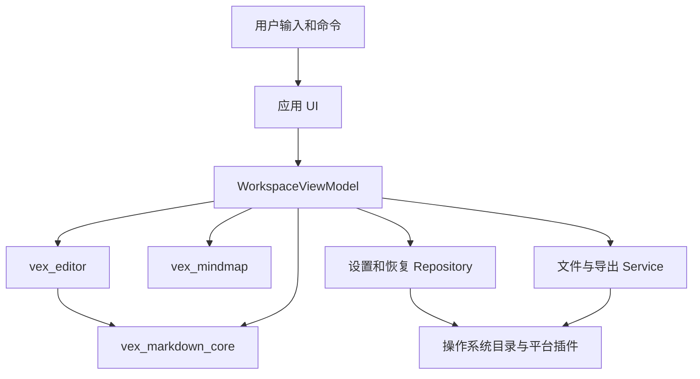
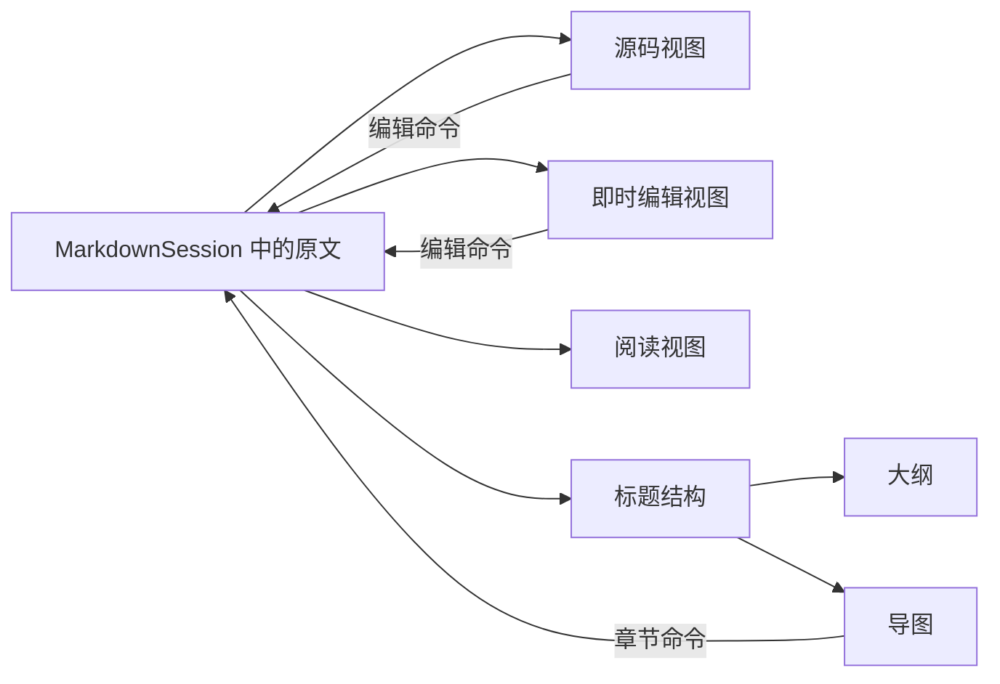
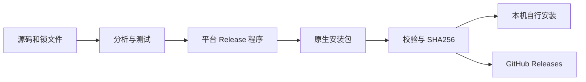

# 维刻 Vex 概要设计

> 概要设计先看“房间怎样分工”，详细设计再看“门怎样开、东西怎样传”。本篇对照当前源码，不把未来目标写成既成事实。

## 1. 总体结构

箭头表示调用或依赖方向，不代表所有数据都必须逐层复制。应用组装各个包，包不反过来认识最终应用。

### 为什么拆成四部分

- **应用**知道当前文件、设置、窗口、菜单和用户选择。
- **Markdown 核心**知道文章结构、源码位置与撤销，不知道窗口长什么样。
- **编辑器**知道如何输入和显示 Markdown，不决定安装路径或发布方式。
- **导图**知道节点如何排列和交互，不要求节点必须来自 Markdown。

这样可以在 `example` 中单独验证控件，也能让核心测试不启动 Flutter 窗口。不是为了让文件数量更多，而是减少职责纠缠。

## 2. 应用内部分层

| 层 | 位置 | 负责 | 示例 |
| --- | --- | --- | --- |
| View | `apps/vex/lib/ui` | 呈现状态、接收动作、显示结果 | 菜单、编辑区、对话框 |
| ViewModel | `ui/workspace/workspace_view_model.dart` | 业务协调和可观察状态 | 当前文档、保存队列、偏好 |
| Domain | `lib/domain` | 业务数据及规则 | 文档、布局、编码、导出选项 |
| Repository | `lib/data/repositories` | 持久化读取与写入 | 设置、恢复草稿 |
| Service | `lib/data/services` | 文件 / 平台能力和任务 | 系统文件框、打印、MCP 服务 |

采用 provider 接入应用状态。`ChangeNotifier` 是“状态变了，请关心它的界面重新读一下”的通知机制。它不是数据库，也不会自动保存文件。

当前 `WorkspaceViewModel` 承担的协调职责较多，是后续可逐步拆分的地方；不应因为采用了 MVVM 名称就认定已经达到所有最佳实践。

## 3. 唯一数据源：Markdown 原文

四种视图不是四份各自保存的文档。否则在导图里重命名后，源码可能不知道，撤销也会互相打架。

核心将解析后的章节、块和源码范围与原文联系起来。章节修改最终变成对原文的替换，再让各个视图读取新的状态。切换布局不需要“导出再导入”。

## 4. 文档状态和磁盘状态分开

| 状态 | 所在位置 | 生命周期 |
| --- | --- | --- |
| 正在编辑的文本、选区、撤销栈 | 内存中的会话和控制器 | 当前应用运行期间 |
| 用户正式保存的 Markdown | 用户选择的文件路径 | 独立于软件安装 |
| 偏好设置 | 系统应用数据目录 | 跨运行保留 |
| 恢复草稿 | 系统应用数据目录 | 故障后尝试恢复，不是历史版本库 |
| 内置鸣谢、更新日志 | 应用打包资源 | 只读，随程序版本更新 |

Windows 程序默认在 `%LOCALAPPDATA%\Programs\Vex`，设置和恢复在 `%APPDATA%\Vex`，不加公司名子目录。具体说明见 [打包与备份](07-本机打包安装升级与数据备份.md)。

### 为什么要有文件服务和仓库接口

真实运行使用 `NativeDocumentFileService`、`NativeSettingsRepository`、`NativeRecoveryRepository`。测试可以换成内存假对象，模拟文件冲突、磁盘失败、异步写入变慢，而不改用户真实笔记。

这叫依赖注入：**由外面把工具交给协调者，而不是协调者在每个动作里自己创建真实磁盘服务。**

## 5. 自适应不是简单缩放

`WorkspaceViewport` 控制允许的最大面板数：手机 1、平板 2、桌面 3。当前规则先看窗口宽度 `<700`，非桌面环境还考虑短边 `<600`；Flutter 的尺寸是逻辑像素，不是截图的物理像素数。

`WorkspaceLayout.constrainedTo` 在布局超出容量时降级。桌面窗口变窄同样可能变成单视图，不能仅凭操作系统名称决定布局。

| 情况 | 设计策略 |
| --- | --- |
| 桌面空间充足 | 并排对照、侧栏、菜单、键盘交互 |
| 平板 | 最多双栏，弹窗仍按可用空间约束 |
| 手机 | 单视图、触控菜单、紧凑但可点击的工具组 |
| 文档型对话框 | 标题与关闭区固定，中间正文滚动 |
| macOS | 系统标题栏、菜单和快捷键习惯单独处理 |

## 6. 图片、图表与导出

图片服务负责本地附件与路径相关任务；阅读器负责显示；导出服务把当前内容转换为目标格式。独立 HTML、PDF、Word 和 PNG 有各自实现，**不是把屏幕截一张图当作所有格式**。

数学使用公式渲染库；Mermaid 使用项目依赖的渲染能力。代码块是明确语言、正文、工具区的复合组件，工具栏不能随着内容长度挤压或盖住最后一行。

同一 Markdown 的屏幕渲染和 PDF / Word 排版并不天然相同。分页、字体嵌入、复杂表格与图表应逐种格式验收。

## 7. MCP 的系统边界

这里 Vex 是本机服务端，不是让编辑器在后台随意调用任意 AI 服务。协议层、权限层、文档命令层各自约束请求；默认关闭，移动平台当前不提供这个本地服务能力。

## 8. 构建和分发

图中两条分发路径有区别：`build-windows.bat` 走到本机安装包即结束；GitHub 发布由已有 tag 工作流完成，不由这个 BAT 自动触发。

同一个 Windows 安装身份允许后续替换程序文件；设置和个人笔记留在独立位置。新的包身份、签名变化和移动端卸载不能套用这一结论。

## 9. 设计取舍

| 选择 | 收益 | 代价 / 边界 |
| --- | --- | --- |
| 原文为唯一数据源 | 内容可迁移、视图一致、便于撤销 | 即时编辑与源位置映射复杂 |
| 本地文件优先 | 用户掌握文件，无账号门槛 | 冲突、编码、文件权限必须处理 |
| 三个复用包 | 可独立测试和复用 | 包 API 与版本维护需要纪律 |
| 简单会话历史 | 易理解、可回归测试 | 完整文本快照对超长文内存有成本 |
| 原生 Flutter | 统一交互与绘制 | 仍需平台工程、插件和设备验收 |

下一篇：[详细设计](04-详细设计.md)。
