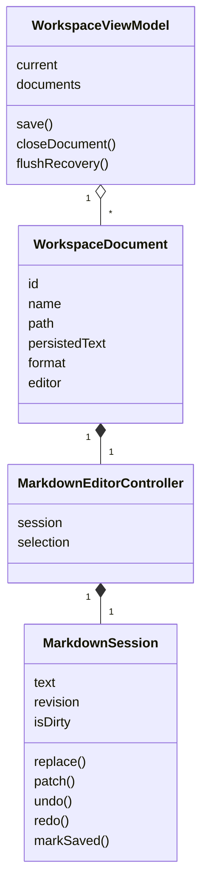
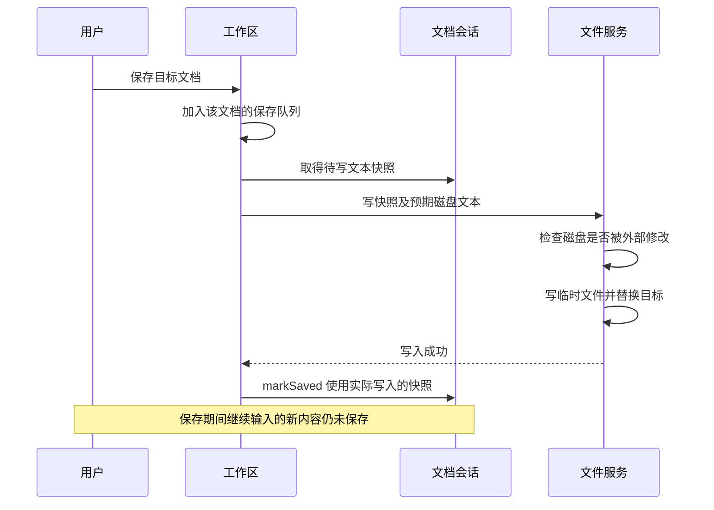

# 维刻 Vex 详细设计

> 本篇是实现地图：先看模型，再顺着一次输入、保存、关闭和恢复追踪数据。文件路径相对于源码仓库根目录。

## 1. 关键对象

图只画学习所需成员，不是完整 API。`WorkspaceDocument` 保存文件身份和编辑器；`MarkdownSession` 保存原文、解析结果、保存基线与历史；界面本身不是文档存储。

| 字段 | 含义 | 为什么存在 |
| --- | --- | --- |
| `id` | 本次工作区中的文档标识 | 没有磁盘路径的新文档也能识别 |
| `path` | 已确定的文件路径，可空 | 新草稿还没选择保存位置 |
| `persistedText` | 已知磁盘文本 | 检测其他软件修改的参考 |
| `format` | 编码与换行格式 | 保存时不无意改变文件约定 |
| `revision` | 会话内容变动计数 | 异步操作回来时识别过期目标 |
| `isDirty` | 当前文本与保存基线不同 | 控制未保存提示与关闭策略 |

## 2. 编辑和统一撤销

源码入口：`packages/vex_markdown_core/lib/src/session.dart`。

1. 编辑器或章节动作产生替换文本 / `TextPatch`。
2. `MarkdownSession.replace` 记录前后文本，清理失效的重做分支。
3. 会话解析新 Markdown，更新 `revision`，通知监听者。
4. 视图按各自需要更新；导图不可见时标记待同步，不立即做树与布局工作。

当前历史最多 500 项，相同 `mergeKey` 且间隔小于 750 毫秒的连续输入可以合并。历史项存完整的前后文本，**不是只存几个字符的差量数据库**。文本改变后会重新解析文档，不宣称完整增量语法树。

### 章节操作的边界

标题有头部、标题文字、正文、整节的源码范围。改名只替换标题文字，移动章节带上子章节。禁止把章节放到自己的后代里面；标题级别不能越过 1～6。命令回到同一会话，所以在导图里调整后也能统一撤销。

## 3. 中文输入法与选区

源码入口：编辑器的 `controller.dart`、`inline_editing_controller.dart`、`source_controller.dart`、`selection_projection.dart`。

Flutter `TextEditingValue` 不只有文本，还包括选区和 `composing` 候选范围。中文输入时，拼音候选是中间态，不能把每次候选刷新都误当成最终文档命令。

处理原则：

- 保留正在组合的临时输入，提交后才形成正常历史边界。
- 保存标记更新不应抹掉候选内容。
- 文档切换或外部内容变化后，不把旧的异步粘贴 / 候选提交到新目标。
- 即时渲染文字的可见位置与 Markdown 源位置不同，需要选区投影。

Windows 源码编辑当前使用 Re-Editor；其他平台的源码入口当前采用 TextField 路径。组件测试覆盖不能代替微软拼音、搜狗、系统日文、触屏选择等真实输入法组合验证。

## 4. 保存流程

源码入口：`workspace_view_model.dart` 的 `_saveDocument`、`_writeDocument`；`file_service.dart` 的 `write`、`_atomicWrite`。

### 两个经常被忽视的问题

**问题一：保存 A 尚未完成，又点保存 B。** 如果没有队列，旧写入有可能晚于新写入结束，磁盘退回旧内容。当前按文档串行协调写入。

**问题二：写入过程中用户又输入了。** 成功时不能简单把“当前全部内容”标成已保存，只能标记真正写出去的文本。否则界面显示已保存，磁盘却缺最后几个字。

### 文件写入保护不是绝对事务

当前先在同目录写 `.vex-时间.tmp`，将旧目标重命名为 `.bak`，再替换，失败时尝试恢复。另有基于预期文本的外部修改检查。

它降低半写入和误覆盖风险，但不是跨应用文件锁或数据库事务；检查与替换之间仍有竞态，断电、损坏、权限、网络盘行为也无法绝对保证。成功后旧 `.bak` 被删除，不能当永久备份。

## 5. 关闭与恢复

源码入口：`closeDocument`、`_closeDocument`、`_queueRecovery`、`flushRecovery`、`restoreDrafts`、`discardDrafts`。

关闭操作捕获目标文档和版本，等待必要的保存 / 恢复处理。等待期间如果有新编辑，不能把新内容一并丢掉；保留草稿失败也不能直接宣称关闭成功。

恢复默认开启，编辑后约 600 毫秒防抖：短时间连续输入合并为一次落盘。关闭、恢复、丢弃、生命周期刷新通过队列协调，避免旧任务在后面复活已丢弃草稿。

`NativeRecoveryRepository` 还串行写入 `recovery-v1.json`，通过 `.tmp` / `.previous` 替换。主文件不存在时可尝试上一文件；当前不是任意损坏文件都能自动修复，更不是保存每次编辑历史的备份系统。

## 6. 文件格式与平台差异

| 情况 | 实现职责 | 用户可见结果 |
| --- | --- | --- |
| UTF-8、UTF-8 BOM、GB18030 | `document_codec.dart` 与文件格式模型 | 尽量保留编码约定，失败有错误 |
| LF / CRLF | 解析范围和保存格式 | 不因 Windows 换行使选区整体错位 |
| 桌面打开文件 | 保留原路径 | 可以检查原文件冲突并保存 |
| 手机系统选择器 | 可能提供缓存副本，路径不当作可直接写回原件 | 通过系统保存流程选择目的地 |
| 文件夹递归枚举 | 文件服务，不跟随目录链接 | 得到 Markdown / 文本文件与子目录，侧栏按树形展示 |

打开有真实路径的文件后，工作区自动枚举其所在目录；若文件已在当前目录树内，保留原根目录与折叠状态，不缩到子目录。正文解析完成即可显示，目录枚举不读取其他文件的正文。较早请求、已关闭工作区和目录访问失败都不能覆盖当前文件；手机选择器仅给出缓存副本时不扫描缓存目录，需要由用户另行授权打开文件夹。

## 7. 阅读、查找、导图、代码块

- **阅读**：由 `vex_editor` 阅读器渲染，正文与代码通过普通文本绘制、`SelectionArea` 处理选择，不为每段正文创建输入框。长文按列表方式组织，并缓存视口前后一屏；章节直接按块索引定位，不先显示估算位置再播放修正动画。
- **查找**：工作区处理结果与动作，输入栏放在编辑区顶部；导航不能抢走搜索框输入焦点。
- **导图**：Markdown 标题转换成通用节点；六种布局由 `vex_mindmap` 的 `layout.dart` 实现。隐藏时延后派生树与布局，显示时同步最新状态。
- **代码块**：稳定工具区尺寸、换行与字号独立设置，横向滚动不能导致末行被覆盖。
- **Mermaid**：`mermaid_catalog.dart` 提供分类模板，`mermaid_block.dart` 负责图形与源码交互；不能只放一个流程图入口。

## 8. 偏好与内置文档

设置仓库通过 `SharedPreferencesAsync` 保存 `workspace-v1` JSON。Windows 插件文件位于应用支持目录的 `shared_preferences.json`。设置持久化失败需要提示，不能因为界面开关已经变了就显示“已保存”。

外观、编辑、文件、图片、导出、水印、导图和 MCP 等选项由对应模型或工作区状态协调。水印的 `preview` / `export` 分开，默认均关闭；当前透明度范围 0～0.5，文本最多 60 个 Unicode 码点。

鸣谢和更新日志从应用资源加载，不复制到用户目录。桌面通过特殊启动参数创建只读文档进程；手机、平板用固定标题和关闭区的对话框，中间正文滚动。

## 9. 导出边界

`export_service.dart` 接受内容、目标格式、纸张边距、图片和水印等选项，生成对应字节，再通过保存能力写出。普通 Markdown 不应被水印文字污染；图形布局与导出分页应分别验证。

当前有离线 PDF 字体资源，但 PDF、HTML、Word 使用不同排版引擎。复杂嵌套结构、数学、Mermaid、远程图片和打印结果仍需目标环境验收，不能只凭字节非空宣布视觉正确。

## 10. MCP 协议与权限

| 边界 | 当前措施 |
| --- | --- |
| 网络 | IPv4 回环地址，只面向本机 |
| 协议 | Streamable HTTP、JSON-RPC、POST JSON |
| 鉴权 | Bearer 令牌；令牌至少 24 字符 |
| 请求约束 | 检查 Host，拒绝 Origin；请求体上限 1 MiB，读取超时 15 秒 |
| 作用范围 | 当前文档、工作区或自定义目录等范围约束 |
| 修改动作 | 默认需要确认；审计记录用于显示操作情况 |
| 平台 | 当前桌面可用，Android / iOS 不启本地服务 |

默认端口 `17891`；配置示例里的 token 不能公开。当前开发分支将令牌放入 `flutter_secure_storage` 平台安全存储，不写普通偏好，存取或回读失败不启动服务。35 个工具已通过官方 Inspector CLI 的隔离环境联调，系统凭据与各真实客户端仍需目标环境验收。详见 [MCP 指南](mcp/MCP使用指南.md)、[接口参考](mcp/MCP工具接口.md) 与 [测试边界](mcp/MCP测试指南.md)。

## 11. 测试怎样对应设计

| 风险 | 主要测试位置 |
| --- | --- |
| 章节范围、CRLF、统一撤销 | `packages/vex_markdown_core/test` |
| 候选输入、选区、代码 / 表格几何、导航 | `packages/vex_editor/test` |
| 节点、布局、缩放、交互 | `packages/vex_mindmap/test` |
| 保存竞态、恢复、偏好、菜单和布局 | `apps/vex/test` |
| 真窗口输入与截图 | `apps/vex/integration_test` |
| 品牌、包名、安装器、产物契约 | `scripts/tests` |

下一篇：[核心原理与源码导读](05-核心原理与源码导读.md)。
