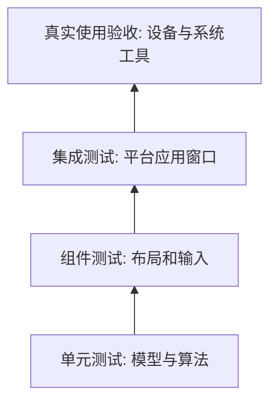

# 开发调试与测试入门

> 本篇以 Windows 开发机为例。所有命令在 PowerShell 中执行；代码框里不带提示符，可以按段执行。不要在运行应用时清理它的构建目录。

## 1. 先装工具，不急着改源码

| 工具 | 作用 | 如何确认 |
| --- | --- | --- |
| Git | 获取源码、查看和提交差异 | `git --version` |
| Flutter SDK | 提供 Flutter 和配套 Dart | `flutter --version` |
| Visual Studio | Windows 原生 C++ 编译工具链 | `flutter doctor -v` |
| VS Code / Android Studio | 写代码和调试的编辑器，二选一即可 | 安装 Flutter / Dart 插件 |
| Python 3.11+ | 发布元信息、品牌和安装包校验脚本 | `python --version` |

Visual Studio 和 Visual Studio Code **不是同一个软件**。只装 VS Code，不能代替 Windows C++ 桌面开发工作负载。

仓库当前固定 Flutter **3.47.7**、配套 Dart **3.13.5**。以 `.flutter-version` 为准，不盲目执行 `flutter upgrade`，也不为了消除错误随意降低项目 SDK 约束。

```powershell
Set-Location D:\github\apps\Vex-Flutter
Get-Content .flutter-version
git status --short
flutter --version
dart --version
flutter doctor -v
flutter devices
python --version
```

找不到 `flutter` 时，将 SDK 的 `bin` 加入 PATH，再重开终端。也可临时用完整路径，PowerShell 运行带引号的路径需要 `&`：

```powershell
& 'C:\tools\flutter\bin\flutter.bat' --version
```

该路径只是示例，请换成实际 SDK 位置。不要把你电脑的绝对 SDK 路径硬编码到仓库。

## 2. 解析依赖与首次运行

在**仓库根目录**执行：

```powershell
Set-Location D:\github\apps\Vex-Flutter
$env:PUB_HOSTED_URL = 'https://pub.dev'
python scripts/sync_builtin_documents.py
flutter pub get --enforce-lockfile
flutter analyze --no-pub
```

然后进入应用目录：

```powershell
Set-Location D:\github\apps\Vex-Flutter\apps\vex
flutter run -d windows
```

Windows 本机制作安装包可直接使用根目录 `publish_win-x64.bat`，入口自动补齐缺失的插件链接。直接执行 `flutter run` 等命令若遇到符号链接权限问题，再按 [本机打包安装升级与数据备份](07-本机打包安装升级与数据备份.md) 的手动步骤处理并还原，不必在每次开发前修改插件清单。

先从 `docs` 生成内置更新日志和鸣谢资源，不需要第三方 Python 包；修改这两份文档后重新生成。`pub get` 解析依赖和工作区，`analyze` 做静态检查，`run` 编译并启动。第一次会比后续慢。依赖提示“有更新版本”不等于出错；先遵守当前锁文件，不要上来批量升级包。

> `flutter run` 启动真实应用，可能使用当前用户的设置和恢复目录。使用空白练习文档，不打开唯一一份重要笔记；要完全隔离个人环境，可使用单独的 Windows 测试账户。仓库内存假对象测试不会替你操作真实笔记。

### 热重载、热重启、重新构建

| 操作 | 一般用途 | 注意 |
| --- | --- | --- |
| Hot Reload，终端 `r` | 修改界面和部分 Dart 逻辑后快速看效果 | 尽量保留现有状态，未必重跑初始化 |
| Hot Restart，终端 `R` | 重新开始 Dart 应用状态 | 内存未保存内容可能丢失 |
| 停止再运行 | 改原生工程、插件、部分资源配置 | 需要完整重新编译 |
| Release 构建 | 准备分发或更真实的性能测量 | 不能用 debug 性能代表正式版 |

先保存练习文档，再重启调试。热重载不是文件备份功能。

## 3. 四组主要测试怎么执行

每段都使用绝对工作目录，避免在上一步的目录里误跑：

```powershell
Set-Location D:\github\apps\Vex-Flutter\packages\vex_markdown_core
dart test --concurrency=2
```

```powershell
Set-Location D:\github\apps\Vex-Flutter\packages\vex_editor
flutter test --no-pub --concurrency=2
```

```powershell
Set-Location D:\github\apps\Vex-Flutter\packages\vex_mindmap
flutter test --no-pub --concurrency=2
```

```powershell
Set-Location D:\github\apps\Vex-Flutter\apps\vex
flutter test --no-pub --concurrency=2
```

纯 Dart 核心不用 Flutter 引擎，所以使用 `dart test`。另外三个含 Flutter 组件，使用 `flutter test`。`--concurrency=2` 限制同时运行的测试套件，降低本机资源压力，不是跳过测试。

脚本契约测试在根目录：

```powershell
Set-Location D:\github\apps\Vex-Flutter
python -m unittest discover -s scripts/tests -v
```

### 测试层级



下层便宜、容易重复；上层能发现更真实的问题，但代价更高。它们互相补充，不是只跑一种即可。

原生窗口集成测试示例：

```powershell
Set-Location D:\github\apps\Vex-Flutter\apps\vex
flutter test --no-pub integration_test/typing_test.dart -d windows
```

这会构建并启动测试窗口，不是普通无窗口组件测试。不要在同一个工作副本同时跑多平台构建和测试，工具可能改写共享的插件注册文件。

## 4. 第一个练习：只验证会话，不碰复杂界面

可在 `packages/vex_markdown_core/test/learn_session_test.dart` 新建练习测试：

```dart
import 'package:test/test.dart';
import 'package:vex_markdown_core/vex_markdown_core.dart';

void main() {
  test('保存基线和撤销', () {
    final session = MarkdownSession('# 初稿\n');
    session.replace('# 初稿\n\n第一段。\n');
    expect(session.isDirty, isTrue);

    session.markSaved();
    expect(session.isDirty, isFalse);

    session.replace('# 初稿\n\n第二段。\n');
    session.undo();
    expect(session.text, '# 初稿\n\n第一段。\n');
    expect(session.isDirty, isFalse);
  });
}
```

执行：

```powershell
Set-Location D:\github\apps\Vex-Flutter\packages\vex_markdown_core
dart test test/learn_session_test.dart
```

这个练习文件尚未替你加入源码仓库，你可以自己动手创建。先让测试通过，再尝试把最后的期望故意改错，观察失败信息，最后恢复正确值。

## 5. 第二个练习：一处可见、低风险的界面改动

推荐选一项翻译或一个局部间距，不碰保存、IME 或路径逻辑。先找到对应 ARB 键，再修改简中译文，执行：

```powershell
Set-Location D:\github\apps\Vex-Flutter\apps\vex
flutter gen-l10n
```

检查生成差异，再运行相关组件测试。当前国际化输出受 Git 管理，不能手工改生成文件而不改 ARB。新增键要同步各语言，不能只在中文界面里硬编码一个字符串。

## 6. 出错时按这个顺序看

| 现象 | 先检查 | 不要立刻做什么 |
| --- | --- | --- |
| 找不到命令 | PATH、终端是否重开、SDK 位置 | 随意复制另一版 SDK 到工程里 |
| 依赖锁定失败 | SDK、`PUB_HOSTED_URL`、网络、锁文件差异 | 删除锁文件后宣称修好了 |
| Windows 构建失败 | `flutter doctor -v` 和 C++ / SDK 组件 | 删除平台源码目录 |
| UI 溢出 | 失败截图、窗口宽度、语言、字号 | 只把文字全部缩小 |
| 测试偶发中断 | 第一条真正错误、内存 / 进程 / 临时目录、重复运行 | 直接删掉失败测试 |
| 安装包制作失败 | `artifacts/build-logs` 本轮日志 | 把旧 EXE 当本轮成功结果 |
| 签名缺失 | 目标平台证书与现有配置 | 把 debug 包冒充正式包 |

## 7. 一次正常提交的顺序

1. 先 `git status --short`，识别原有未提交内容。
2. 只改一个清楚的逻辑，配对应测试。
3. 格式化、分析、测试，核对 `git diff`。
4. 只暂存自己这次要提交的文件，写清中文提交说明。
5. 通过仓库 SSH origin 推送；确认远端提交一致。

不要为了“干净”而 `git reset --hard`；不要把 `.signing`、配置令牌或私人笔记加进去。日常功能提交不需要每次升级版本、打 tag；正式发版才走发布流程。

下一篇：[本机打包安装升级与数据备份](07-本机打包安装升级与数据备份.md)。
