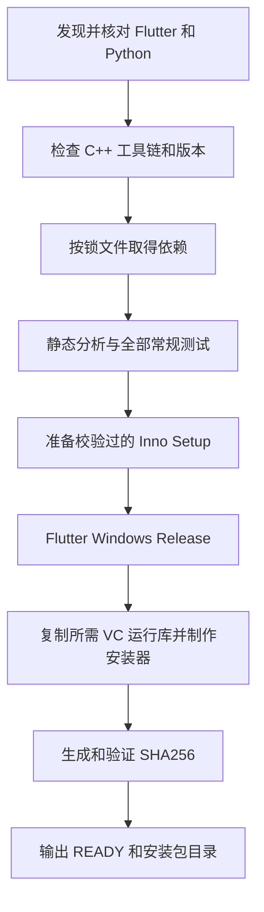

# 本机打包、安装、升级与数据备份

> 直接回答：**可以在当前 Windows 电脑双击 BAT 制作安装包，成功后再自行双击生成的 EXE 安装。设置和恢复草稿不保存在程序安装目录。** 但首次需要准备开发工具，打包不是脱离工具链的一键魔法。

## 1. 四个动作不要混淆

| 动作 | 输入 | 输出 | 会自动改变你的安装吗 |
| --- | --- | --- | --- |
| 运行开发版 | 源码、SDK、平台工具链 | 调试进程 | 不会安装，但真实运行可能读取当前用户配置 |
| 编译 Release | 源码、锁文件 | EXE、DLL、资源等整套程序 | 不会 |
| 制作安装包 | Release 程序、安装器源码 | 可双击的 setup.exe | 不会 |
| 安装 / 升级 | setup.exe | 安装目录、快捷方式、应用注册 | 会，由你确认执行 |

**发布到 GitHub** 又是另一件事：推送符合版本规则的 tag，触发 CI 测试和多平台安装包工作流。本机 BAT 不会替你提交、打 tag、上传或发布。

## 2. 最简单的 Windows 打包方法

源码入口：`D:\github\apps\Vex-Flutter\build-windows.bat`。

1. 准备 `.flutter-version` 固定的 Flutter SDK，当前为 `3.47.7`。
2. 安装 Python 3.11+，确认 `python` 可用。
3. 安装 Visual Studio「使用 C++ 的桌面开发」和 Windows SDK。
4. 在资源管理器双击根目录 `build-windows.bat`。
5. 等待终端输出 **`READY`**，成功后打开产物目录。
6. 关闭正在使用的 Vex，自行双击新生成的安装包。

脚本失败会输出错误与日志位置并保留窗口，不能把“窗口运行过”当作成功。脚本只自动准备固定版 Inno Setup，不替你安装 Flutter / VS / Python，也不自动安装 Vex。

本机打包使用**当前工作区内容，包括未提交修改**，不会先切换到远端版本；因此安装包成功不代表代码已经提交和推送。2026-10-18 已通过静态分析、423 项 Dart / Flutter 测试、42 项 Python 测试和 Windows 安装包校验；本机预览版编译器首次崩溃中止，改为单并发后重试打包成功，未自动安装产品。

### 自动执行的步骤



默认包括核心、编辑器、导图、应用四组测试和 Python 脚本契约测试。它**不自动执行平台窗口集成测试，也不安装 / 卸载产品来验证**；正式发布仍需相应验收和 CI。

### 结果在哪里

当版本为 `0.2.2+4` 时：

```text
Vex-Flutter/
├─ artifacts/
│  ├─ local/
│  │  └─ win-x64/
│  │     └─ v0.2.2-build4/
│  │        ├─ Vex-v0.2.2-windows-x64-setup.exe
│  │        └─ Vex-v0.2.2-windows-x64-setup.exe.sha256
│  └─ build-logs/
│     └─ windows-日期-时间.log
└─ apps/vex/build/windows/x64/runner/Release/
   ├─ vex.exe
   ├─ flutter_windows.dll
   ├─ 其他 DLL
   └─ data/
```

输出目录会随版本和构建号变化。重复构建同版本会更新同名文件；失败时旧文件可能还在，必须以本轮 `READY` 和日志为准。

`0.2.2+4` 中，`0.2.2` 是用户可见版本，`4` 是构建号，来自 `apps/vex/pubspec.yaml`；Git 标签通常对应 `v0.2.2`。独立包的版本属于包 API，可以与最终应用不同；Flutter SDK 版本则是开发工具版本，三者不要混淆。脚本读取现有版本，不自行加版本号。

**不要只把 Release 目录里的 `vex.exe` 单独拷走。** 它需要 DLL 和资源。分发给自己或他人时用 setup.exe，安装后的程序不需要对方安装 Flutter、Python 或 Visual Studio。

### 其他平台也有统一入口

脚本已按平台归类到 `scripts/packaging/`，各目录的 `build.bat` / `build.sh` 是快捷入口；也可在仓库根目录使用统一命令：

| 目标 | 命令中的目标参数 | 所需电脑 |
| --- | --- | --- |
| Windows x64 | `win-x64` | Windows + Visual Studio C++ |
| Linux x64 / ARM64 | `linux-x64` / `linux-arm64` | 对应架构 Ubuntu 24.04 |
| macOS Intel / Apple 芯片 | `osx-x64` / `osx-arm64` / `osx-universal` | macOS + Xcode；均生成同一个通用 DMG，只跑一次即可 |
| Android | `android` | Windows / Linux / macOS + Android SDK、JDK 与原发行签名 |
| iOS 编译检查 | `ios-check` | macOS + Xcode；无可安装 IPA |

例如：`python scripts/packaging/build.py win-x64 --check-only`。macOS / Linux 将 `python` 换成 `python3`。`--dry-run` 可在任意电脑仅预览配方，不执行构建。各平台本机产物统一保存到 `artifacts/local/目标/v版本-build构建号/`。

Windows 不能仅靠改目标参数直接构建 Linux / macOS 安装包；脚本会明确检查宿主。Android 正式签名需要另行安全恢复，并设置公开指纹 `ANDROID_CERT_SHA256`。全部说明见仓库 `scripts/packaging/README.md`。

## 3. 找不到工具时怎样配置

脚本按顺序查找 Flutter：命令参数 → `VEX_FLUTTER` → `FLUTTER_ROOT` → PATH → 已解析工作区的生成配置。最后一种只是当前电脑的便利，不是换机方案。

在仓库根目录可执行：

```powershell
.\build-windows.bat -CheckOnly
.\build-windows.bat -Flutter C:\tools\flutter\bin\flutter.bat
.\build-windows.bat -Compiler 'C:\tools\inno\ISCC.exe'
.\build-windows.bat -NoOpenFolder
```

| 参数 | 用处 |
| --- | --- |
| `-CheckOnly` | 只查工具与版本，不解析依赖、不下载或安装 Inno |
| `-Flutter` | 明确指定 flutter.bat，不升级 SDK |
| `-Compiler` | 使用现有 Inno 编译器，建议与固定版一致 |
| `-NoOpenFolder` | 成功后不打开资源管理器 |
| `-SkipTests` | 明确跳过分析与测试，不建议作为平时默认 |

自动调用可设进程环境变量 `VEX_NO_PAUSE=1`，BAT 不再等待按键，仍保留失败退出码。双击场景无需设置。

Inno 下载源为官方 GitHub 发布，固定版本 `6.7.2`；缓存下载也必须匹配固定 SHA-256，再校验发布者签名。无网络又无缓存 / 编译器时会失败，不会悄悄换一个未知版本。

Windows 安装器目前没有 Authenticode 发行证书。SmartScreen 可能警告；`.sha256` 是完整性校验，不等于 Windows 信任签名。不要因此把安全提醒描述为软件已经获得系统认证。

## 4. 三个位置一定分开认识

| 内容 | 当前 Windows 默认位置 | 被安装器升级覆盖吗 |
| --- | --- | --- |
| 程序与内置资源 | `%LOCALAPPDATA%\Programs\Vex` | 正常升级会替换这里的程序文件 |
| 偏好与恢复草稿 | `%APPDATA%\Vex` | 当前安装器没有清理这里的规则 |
| 正式 Markdown、图片和附件 | 你自行选择的位置 | 不应作为程序安装内容处理 |

在资源管理器地址栏输入 `%APPDATA%\Vex` 即可定位用户数据。路径由平台 API 和 Windows 元数据中的产品 `Vex` 决定；公司字段留空，不再增加公司名子目录，也不是硬编码到每台电脑同一个用户名。此前目录中的数据不会自动搬迁或删除，迁移前应关闭应用、备份新旧目录，避免覆盖新数据。

### 数据文件有什么

| 文件 | 用处 | 注意 |
| --- | --- | --- |
| `shared_preferences.json` | 插件保存设置，包含 `workspace-v1` 数据 | 可能含 MCP 令牌，不应公开 |
| `recovery-v1.json` | 未保存文档恢复快照 | 不是每次编辑的版本档案 |
| `.tmp`、`.previous` 等 | 写入替换过程的临时保护 | 成功后可能删除，不是长期备份 |

文件通常在使用或保存相应功能后产生；没看到某个文件不一定是故障。目录里也可能存在历史版本或其他实现留下的文件，不要仅凭文件名就删除。

内置鸣谢、更新日志随程序打包、只读，不复制成用户可编辑文件。正式笔记则保持用户拥有，不依附内置资源。

## 5. 安装、升级、卸载会怎样

### 同一身份的正常升级

当前 Windows 安装采用按用户方式，默认不要求管理员权限。相同用户、相同应用身份和既有安装升级标识下，覆盖安装 / 修复 / 升级替换程序文件，保留独立用户数据与个人笔记。已有安装时可能出现维护 / 修复入口，以安装器实际界面为准。

升级前先保存并关闭软件，不要让旧版本进程和新版本同时操作恢复文件。安装器虽然有关闭应用检测，也不能代替你确认工作已保存。

### 卸载

当前 Windows 安装器不删除上述应用支持目录，正常卸载也不删除你另行保存的 `.md`。因此卸载后重装可能读到原有偏好。**想清空设置是单独的用户数据操作，应该先备份，不应混入普通卸载。**

### 不能做的保证

- 更换应用包标识、公司 / 产品元数据、平台签名，可能成为新应用身份；旧设置和草稿不会自动迁移。
- 换 Windows 用户不共享同一用户目录。
- 新版本的数据格式可能不兼容旧版本；不要默认支持任意降级。
- 磁盘损坏、断电、清理软件和人为删除仍可能导致数据丢失。
- Android / iOS 卸载通常删除应用沙箱，不能套用 Windows 卸载保留规则。

所以答案是：**结构上已经把程序与数据分离，正常同身份升级不应影响数据；但仍需要独立备份，不能承诺任何操作都绝不丢失。**

## 6. 一份可执行的备份清单

- [ ] 在 Vex 中把重要草稿保存成真正的 `.md`。
- [ ] 关闭所有 Vex 窗口，避免备份时配置还在变化。
- [ ] 备份整个笔记目录，包含图片和其他相对路径附件。
- [ ] 单独备份 `%APPDATA%\Vex`，包含设置和恢复数据。
- [ ] 将含令牌的配置备份加密，不发到公开仓库或群聊。
- [ ] 开发者另行加密备份 `.signing`、keystore 和配套信息。
- [ ] 记录应用版本、系统和备份日期。
- [ ] 在另一位置检查文件确实存在、能打开，而不是只看到一个空文件夹。

还原用户数据前关闭应用；先保留新电脑原数据副本，再还原同身份、相近版本的数据。对正式笔记，可先在 Vex 里直接打开验证，不必把笔记复制进配置目录。

## 7. 换电脑到底要带哪些

| 东西 | 随 Git 克隆回来吗 | 换机动作 |
| --- | --- | --- |
| 已提交源码、安装器与静态资源 | 是 | 克隆并核对远端提交 |
| 未提交修改、未跟踪学习稿 | 否 | 检查 Git 状态，提交或单独备份 |
| 本套文档 `docs/00` 至 `docs/08` 与 `docs/assets` | 提交后是 | 随仓库克隆，未提交的练习修改另行备份 |
| Flutter / VS / Python 等工具 | 否 | 在新电脑按固定版本安装 |
| build、Pub 缓存、artifacts | 否 | 一般重新生成，需留档的安装包和截图另存 |
| Android 发行密钥、密码 | 否 | 加密迁移并验证可用，不重新生成替代 |
| GitHub Secrets | 不会下载到本机 | 仍留在仓库服务端，按权限管理 |
| 用户笔记、配置、恢复草稿 | 否 | 按上一节独立备份与还原 |

## 8. 其他平台与 GitHub 发布

当前发布配方目标为 Windows EXE、macOS 通用 DMG、Linux x64 / ARM64 DEB、Android 三架构正式签名 APK，共七个安装包及各自校验文件。以具体 GitHub Actions 成功结果和 Release 实际附件为准。

Windows 本机 BAT **只产 Windows x64 包**。macOS / iOS 构建需要 macOS 工具链；Android、Linux 也有各自配方，不能靠同一个 Windows BAT 跨编全部原生安装包。iOS 和 HarmonyOS 按已确认决定暂缓发布可安装包，待证书和适配条件具备再补。

正式自动发布入口是 `.github/workflows/release.yml`；细则见源码仓库 `docs/安装包与自动发布.md`。学习或本机试装不必立刻发版，也不要为了测试移动已有 tag。

下一篇：[Markdown 阅读练习](08-Markdown阅读练习.md)。
