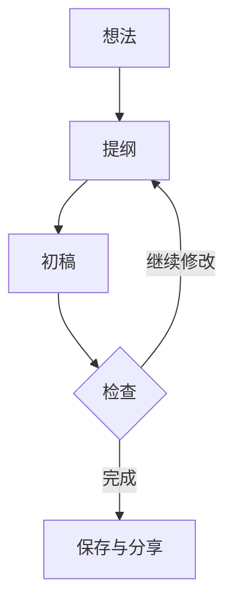
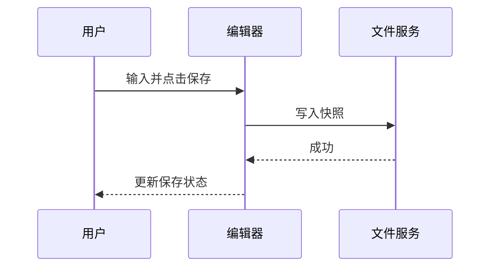
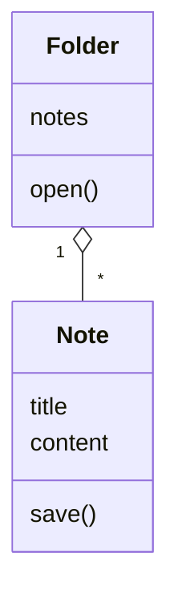
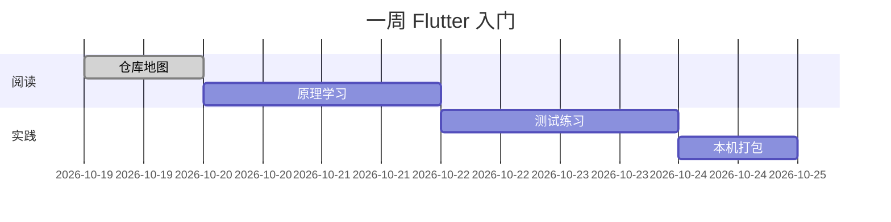
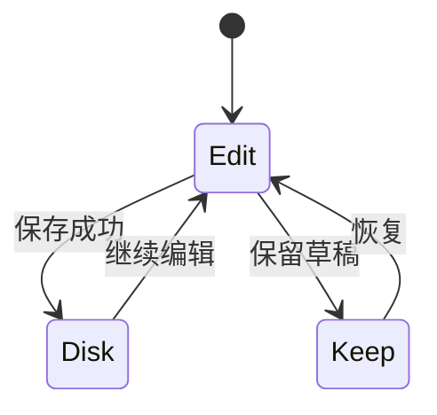
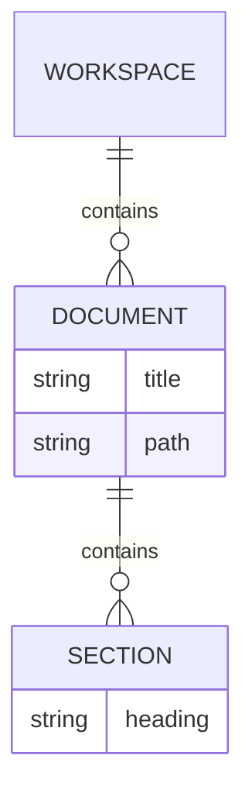
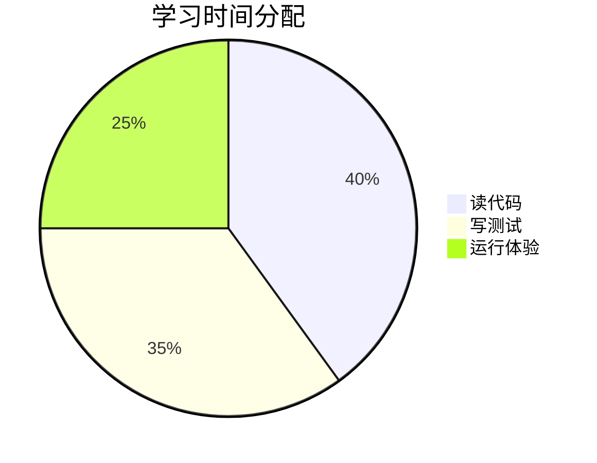
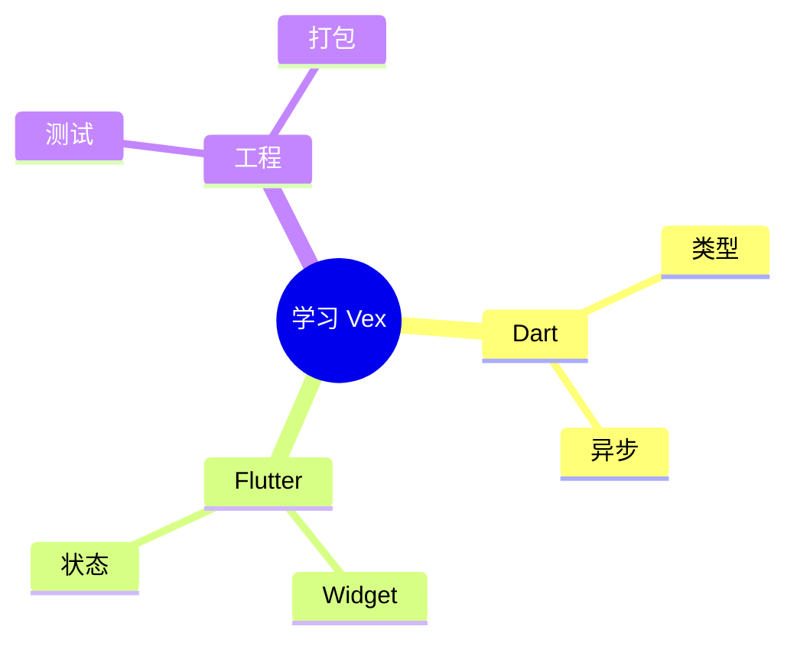

# Markdown 阅读与编辑练习

> 这篇是可修改的练习材料。建议先另存一份 `我的练习.md`，和 `assets` 保持相对位置，再尝试编辑、撤销与导出；不要用唯一一份重要文档测试边界行为。

## 1. 标题、段落与行内样式

### 三级标题：今天认识 Flutter

这是一段普通正文。**粗体**适合重点，*斜体*适合强调，~~删除线~~表示旧计划，`MarkdownSession` 表示代码标识。

Markdown 的空行通常用于分段。源文件怎样分行，不一定等于阅读时怎样换行；切换源码与阅读可以观察区别。

#### 四级标题

##### 五级标题

###### 六级标题

> 引用块可以放补充说明。
>
> **提醒：恢复草稿不是永久备份。**

---

## 2. 列表与任务

无序列表：

- 阅读仓库地图。
- 打开 `main.dart`。
- 完成第一个测试。

有序列表：

1. 创建练习文档。
2. 写入一段内容。
3. 保存，再修改，最后撤销。

任务列表：

- [x] 找到应用入口。
- [ ] 认识 provider。
- [ ] 制作 Windows 安装包。

嵌套结构：

- Flutter 学习
  - Dart 基础
  - Widget 与状态
- 项目实践
  - 文件读写
  - 导图与阅读

## 3. 表格与对齐

| 模块 | 语言 | 测试工具 | 学习优先级 |
| :--- | :---: | :---: | ---: |
| Markdown 核心 | Dart | dart test | 1 |
| 编辑器 | Dart / Flutter | flutter test | 2 |
| 应用 | Dart / 平台代码 | flutter test | 3 |
| 发布脚本 | PowerShell / Python | unittest | 4 |

试着在练习副本里给表格加一行、移动一列、改变对齐，再撤销，核对源码有没有变化。带竖线的单元格：

| 内容 | 含义 |
| --- | --- |
| A \| B | 这里的竖线属于单元格内容 |
| `bool` | 代码标识 |

## 4. 链接与本地图片

[Flutter 官方学习入口](https://docs.flutter.dev/get-started)

[返回本套文档索引](00-从这里开始.md)

相对 Markdown 文档链接在通用阅读器中可导航；当前 Vex 不应假设已经支持打开本地文档链接，可改用文件列表。这个差异也值得实际体验和记录。

下面的图片来自仓库原有 Logo 的副本，不依赖网络。请连同 `assets` 一起迁移：


## 5. 代码块

### Dart

```dart
class LearningPlan {
  LearningPlan(this.topic);

  final String topic;
  final tasks = <String>['阅读目录', '运行测试'];

  String summary() => '$topic：共 ${tasks.length} 项任务';
}

void main() {
  final plan = LearningPlan('Flutter');
  print(plan.summary());
}
```

### JSON

```json
{
  "application": "Vex",
  "autosave": false,
  "recovery": true,
  "note": "教学示例，不是可直接覆盖真实设置文件的完整配置"
}
```

### PowerShell

```powershell
Set-Location D:\github\apps\Vex-Flutter
.\build-windows.bat -CheckOnly
```

### 一行较长的文本

```text
Vex keeps Markdown as the source of truth; source editing, instant editing, reading, outline navigation, and mind-map views should agree on the same document and undo history.
```

观察横向滚动、自动换行、字号变化、复制按钮和代码最后一行的位置。宽度不足应由块内滚动或换行处理，不能把整个应用横向撑开。

## 6. 数学公式

行内公式：若已有 $n$ 项任务，再完成 1 项，完成数可写为 $n+1$。

独立公式：

$$
P = \frac{N_{done}}{N_{total}} \times 100\%
$$

再来一个平方和：

$$
a^2+b^2=c^2
$$

数学显示、编辑和导出属于不同验收点。请分别检查阅读、PDF 和 Word，不把阅读成功当成全部成功。

## 7. Mermaid 图表示例

以下选择常用图表来学习。它们是文档中的 Mermaid 代码，不是 Vex 原生导图布局设置。

### 流程图



### 时序图



### 类图



### 甘特图



### 状态图



`Edit` 表示编辑中，`Disk` 表示已保存，`Keep` 表示待恢复草稿。图中状态名称只是示例，不是源码类名。

### 实体关系图



### 饼图



### Mermaid 思维导图



更多模板在软件的 Mermaid 插入 / 示例入口。不同 Mermaid 图表、交互和导出支持以具体实现为准；遇到错误应保留源码便于检查。

## 8. 用本篇测试原生导图

切到 Vex 的导图视图：这些标题应形成结构。依次试右向、左右平衡、放射、向下、组织结构、鱼骨布局，缩放后适应视口，再定位回正文。

这里只改变布局不应改写 Markdown；在允许编辑的章节动作中改名，才应改动源码，并能通过统一撤销恢复。

## 9. 一张体验记录表

| 检查项 | 预期 | 实测记录 |
| --- | --- | --- |
| 源码 / 阅读切换 | 内容不丢、未保存状态不乱 | 待填写 |
| 表格菜单 | 能展开，不撑出页面横向滚动 | 待填写 |
| 代码长行 | 工具不压正文，最后一行完整 | 待填写 |
| Mermaid 源码 / 预览 | 两种状态可检查 | 待填写 |
| 预览水印 | 开关、文字、透明度有效 | 待填写 |
| 导出水印 | 与预览独立，目标格式实际检查 | 待填写 |
| 打字机 | 光标行居中、输入不中断 | 待填写 |
| 关闭未保存文档 | 保存 / 保留 / 取消路径清楚 | 待填写 |
| 小屏对话框 | 标题、关闭固定，中间单独滚动 | 待填写 |

复制本表后记录窗口尺寸、系统、输入法和 Vex 版本。具体复现步骤比一句“感觉不对”更容易定位问题。

## 10. 纯文本依然有价值

即使某种图表、数学或本地链接尚未完美呈现，源文件仍然是可迁移的 Markdown。不要为了让一张截图好看而丢掉原文；阅读与导出的差异应作为软件改进线索保留下来。

返回：[从这里开始](00-从这里开始.md)。
