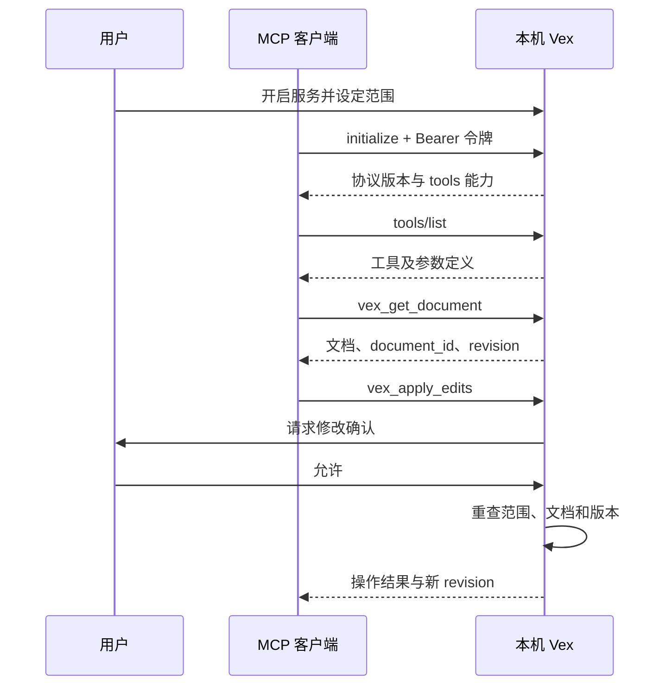

# 使用 Vex 的本机 MCP 服务

> 面向 v0.4.0 起的实现；较早的 v0.3.1 不具备本文全部接口。各平台实测边界见 [测试说明](MCP测试指南.md)。
> MCP 是外部工具与 Vex 沟通的协议，不是内置 AI，也不是云同步。

## 从哪里开始

| 文档 | 内容 |
| --- | --- |
| 本页 | 开启、连接、权限、停止和常见问题 |
| [接口参考](MCP工具接口.md) | 35 个工具、参数、返回值和安全修改示例 |
| [Inspector 与回归测试](MCP测试指南.md) | 官方工具的操作方法、可重复测试和验证边界 |

## 可以做什么

客户端可以读取当前文档、选区和大纲，在授权目录内列出或读取 Markdown 文件，查找内容，经确认后修改正文和章节，并控制部分视图设置。导图来自文档标题树，修改章节会同步改变正文和导图。

目前只提供 **Tools**，不声明 Resources、Prompts、订阅或远程服务能力。导出、打印、删除磁盘文件、安装更新、执行命令和任意偏好读写没有开放给 MCP。接口齐全的判断依据是[已发布的工具范围](MCP工具接口.md)，不是把软件所有按钮都暴露出去。

Windows、macOS、Linux 桌面允许启用；Android、iOS 不启动常驻 MCP 服务。macOS / Linux 的凭据系统与原生文件授权仍需要对应系统验收；不把 Windows 测试等同于跨平台通过。

## 开启与连接

1. 在 Vex 的「偏好设置 → MCP」中设置访问范围，建议先保留「当前文档」和「修改前确认」。
2. 启用服务。默认地址为 `http://127.0.0.1:17891/mcp/`，更改端口后以界面实际地址为准。
3. 点击「测试连接」确认应用内自测成功，再复制客户端配置。
4. 在支持 **Streamable HTTP 和自定义请求头** 的客户端中添加服务器，填写 URL 和 `Authorization: Bearer <令牌>`。
5. 先调用 `vex_get_capabilities`、`vex_get_document`，使用专门的副本文档试验修改。

通用配置示意如下。不同客户端的配置字段可能不同；只支持 stdio 的客户端不能直接使用这段配置。

```json
{
  "mcpServers": {
    "vex": {
      "url": "http://127.0.0.1:17891/mcp/",
      "headers": {
        "Authorization": "Bearer <从 Vex 复制的访问令牌>"
      }
    }
  }
}
```



## 权限与数据安全

| 设置或边界 | 实际含义 |
| --- | --- |
| 默认关闭 | 日常编辑不需要打开服务；开启状态会随偏好保存 |
| 当前文档 `document` | 可以读改当前文档，包括未保存草稿；不能借文件路径打开别的文档 |
| 工作区 `folder` | 当前选定文件夹及子目录；未选目录时采用当前文件所在目录 |
| 自定义目录 `custom` | 只允许指定目录及其子目录 |
| 文件类型 | 路径读取与打开仅支持 `.md`、`.markdown`、`.txt`，大小写不敏感 |
| 修改前确认 | 默认开启；修改正文、保存、撤销、切换文档、选择范围及改变界面的调用都要确认 |
| 过期保护 | 等待确认时文档变更、切换或访问设置改变，会拒绝该请求；输入法组字期间也不修改 |
| 路径检查 | 解析符号链接后的真实路径必须仍在范围内；文件列表过滤越界条目 |
| 访问令牌 | 通过 `flutter_secure_storage` 平台安全存储保存，不写入普通偏好；存取或回读失败时不启动服务，不回退为明文 |
| 操作记录 | 当前进程最多保存最近 100 条工具名、UTC 时间和结果；不保存参数、正文、路径、令牌，不是永久审计日志 |

Windows 当前插件使用 DPAPI 保护应用数据目录中的加密凭据，macOS 使用 Keychain，Linux 依赖 Secret Service。Linux 桌面需要可用且已解锁的密钥服务；构建需要 `libsecret-1-dev`。没有系统凭据环境时不应绕过失败改用明文文件。

服务只监听 IPv4 回环地址，检查 Host、拒绝带 Origin 的请求，**没有浏览器 CORS 开放、OAuth 登录、TLS 或公网部署模式**。不需要映射端口或放行公网防火墙。浏览器版 Inspector 应通过它自己的本地代理连接，不要为直接网页访问放开 Origin 检查。

> 本机并不等于绝对安全。相同系统账户下的恶意程序仍可能获取凭据或访问文件；客户端拿到正文后，也可能按它自己的设置发送给外部模型。请分别检查客户端的数据政策和权限。

不要把真实令牌、含令牌的客户端配置、剪贴板截图或完整用户配置目录上传到 GitHub。关闭服务不会清除系统安全存储中的令牌；疑似泄露时关闭服务、重新生成令牌再连接，旧令牌在新配置生效后失效。换电脑重新生成令牌，不直接复制系统加密凭据文件。

## 停止与排错

在 MCP 设置中关闭服务或退出 Vex 即停止监听；已经在等待用户确认的请求会被拒绝。这里没有后台独立守护进程。

| 现象 | 检查方法 |
| --- | --- |
| 无法连接 | Vex 是否运行、MCP 是否启用、URL/端口是否一致；先执行应用内测试 |
| HTTP 401 | 缺少或使用了旧令牌；重新复制配置，不要在 Issue 中粘贴令牌 |
| HTTP 403 | Host 不正确或请求携带 Origin；不要使用远程地址，不要修改服务放开网页访问 |
| HTTP 405 | 本服务仅接受 POST；GET/SSE 流与 DELETE 会话接口没有实现，这是无状态 HTTP 的边界 |
| HTTP 400 / 415 / 413 | 协议版本或 JSON 不正确、Content-Type 非 JSON，或单请求超过 1 MiB |
| 启动失败 | 端口被占用、系统凭据库不可用；更换端口或解锁系统密钥服务后重试 |
| 工具返回 `isError: true` | 用户拒绝、文件越界、文档已变化或其他业务失败；重新读取，不要盲目重试写入 |
| 路径无法访问 | 必须是范围内现有文件的本地绝对路径，且实际文件名扩展名允许；沙箱系统还需授权目录访问 |
| 看不到未保存文字 | `vex_read_file` 读取磁盘；当前编辑缓冲区请用 `vex_get_document` |

更多安全说明：[安全政策](../../SECURITY.md)。
