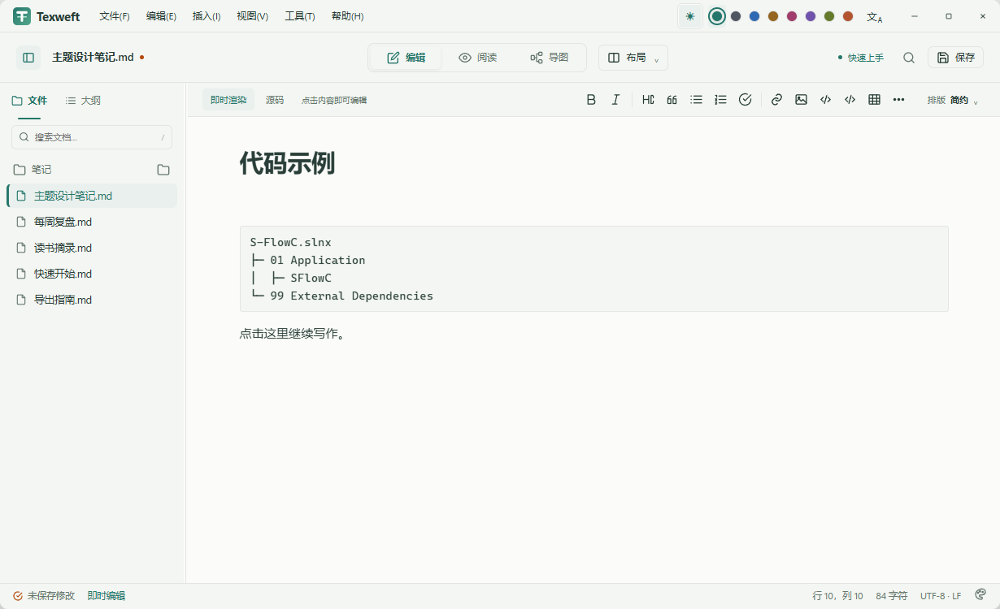
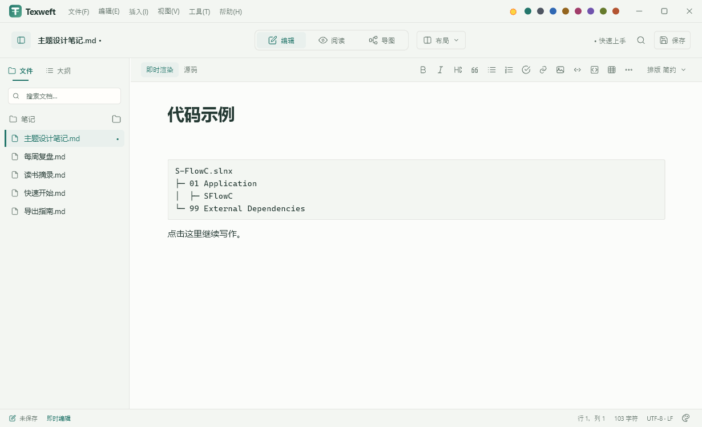

# 原型对照与交互验证（2026-10-17）

当前不能认定达到 98%。本轮修正按钮、侧栏、工作栏和普通正文点击位移，并建立可重复的原生测量入口。

## 测量条件

- Windows 原生 Flutter 客户区 1230×750，DPR 1；`visual_parity_test.dart` 使用内存仓储，不修改用户文件。
- 对照历史原型截图的内部区域 `(25,25)-(1255,775)`；截图内容为相同标题、代码和段落。
- 字体栅格、光标位置、未保存提示与状态栏内容并未完全统一。修正前的集成测试未开启真实窗口按钮，修正后已开启。因此像素误差只能定位区域差异，不能转换为产品还原率。
- `measurements.json` 单独统计标题栏、工作栏、侧栏、格式栏、正文内容及状态栏；正文只取内容区域，排除大块空白。前景误差使用两图深于 190 的像素并集，防止背景占比掩盖文字、图标差异。

## 已验证结果

| 指标 | 修正前 | 修正后 |
| --- | ---: | ---: |
| 布局按钮高度 | 22 px | 32 px |
| 排版按钮高度 | 20 px | 32 px |
| 浮层关闭按钮 | 32×16 px | 32×32 px |
| 点击一级标题后代码块纵向位移 | −16 px | 0 px |
| 点击代码后后续段落纵向位移 | 未采集 | 0 px |

普通正文和 h1–h6 使用相同的显示/输入样式、段间距与标题装饰。六套排版、两种间距共 84 个点击场景，检查首字位置误差不超过 0.01 px、后续段落矩形不变，且点击不产生修改状态。它们是特定内容的回归结果，不代表全部 Markdown 语法都已通过。

语言输入框在代码块下方浮动，不再挤动后文。对话框、浮层和章节面板共用 32 px 关闭按钮；下拉箭头改为独立 SVG，与文字居中对齐。侧栏改为紧凑文字标签及短下划线，工作栏的布局选择靠近视图切换。

## 对照图

原型：

实现：

[半透明叠加](overlay.png) · [差异放大四倍](difference-x4.png) · [原始测量数据](measurements.json)

## 尚需完成的验证

- 行内粗体、链接、列表、引用、表格和图片点击编辑时的字形与段落稳定性；当前实现会暴露部分 Markdown 语法。
- 八种布局、六套排版、八种配色、深浅模式及三类屏幕的完整对照矩阵。
- 标题栏语言入口、色板选中状态、格式栏提示、精确基线及状态栏密度仍有差异。
- 代码高亮、复杂公式、图表和跨块选择尚不能按完整编辑器体验验收。
- 大文档的切换、滚动、各视图内存与帧耗时另行建立 Profile 实测报告。

## 关于与鸣谢

关于改为实际作者、仓库、Texweft 的 MIT 许可；程序版本由 `package_info_plus` 读取当前安装包。四种语言同步更新鸣谢，移除过时的规划文字和其他产品引用。

原型的 `project-info.js` 与 `Third-Party-Licenses.html` 由 `scripts/sync_project_info.py` 从实际 pubspec、依赖源目录和字体许可证生成，当前列出 25 项主要组件与字体。应用的完整第三方声明由 Flutter `LicenseRegistry` 提供，含间接依赖及已注册字体；不将所有第三方组件统称为 MIT。

复测命令见两个脚本的 `--help` 及集成测试源码。所有外部压力样本文档保持只读。
