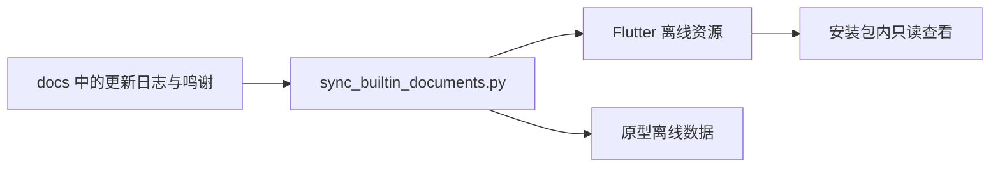

# 文档导航

说明文档的正文统一在本目录维护；根目录保留项目首页，各源码目录只保留简短链接入口。第三方 LICENSE、NOTICE 与字体许可随资源保留，不作为重复说明文档删除。

正文文件名尽量使用中文，MCP、Markdown 等技术名词保留原名。仓库外层 `README.md`、`CONTRIBUTING.md`、`SECURITY.md` 和组件 `CHANGELOG.md` 保留社区惯例文件名，但除项目首页外均只是链接；GitHub 模板按平台规定保留原名。

| 想了解什么 | 从这里开始 |
| --- | --- |
| Flutter 入门、需求和架构 | [从零认识维刻 Vex](00-从这里开始.md) |
| 版本变化 | [更新日志](更新日志.md) |
| 开源依赖与贡献者 | [鸣谢](鸣谢.md) |
| 桌面、手机、平板与安装原型 | [原型设计](design/原型设计.md) |
| 脚本与本机、CI 打包 | [脚本导航](development/脚本导航.md)、[打包与发布](development/打包与发布.md) |
| 应用开发与首页媒体 | [应用开发](development/应用开发.md)、[媒体采集](development/首页媒体采集.md) |
| 编辑器、导图和文档核心 | [编辑器组件](packages/vex_editor/编辑器组件.md)、[导图组件](packages/vex_mindmap/导图组件.md)、[Markdown 核心](packages/vex_markdown_core/Markdown核心组件.md) |
| MCP 使用、工具和联调 | [MCP 指南](mcp/MCP使用指南.md) |
| 字体、品牌、离线原型依赖 | [字体](resources/字体资源与许可.md)、[品牌](resources/品牌资源同步.md)、[离线依赖](resources/原型离线依赖.md)、[安装器语言](resources/安装器语言.md) |
| 贡献与安全 | [贡献指南](贡献指南.md)、[安全政策](安全政策.md) |

`media/` 是首页使用的图片和 GIF，`assets/` 是学习文档的配图。

应用更新日志与各独立包的版本历史属于不同职责，不合并；它们的正文都在本目录。GitHub Release 说明是某次发行的快照，不再复制一套持续维护的完整更新日志。

## 内置文档如何进入软件

生成物被 Git 忽略，不手工维护。CI 和完整打包入口先生成再验证；原型预览服务自动刷新。直接打开 HTML 或手动运行 Flutter 前，在仓库根目录运行 `python scripts/sync_builtin_documents.py`。安装软件后无需 Python、源码目录或联网即可查看这两份文档，也不复制到用户目录。
