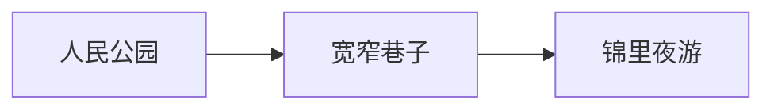

# 成都慢游 · 新手引导演示剧本

> 讨论稿。先确认剧情、动作、文案和节奏，再修改原型。本文是供人评审的剧本，暂不写成程序配置。

## 一、这段引导要讲什么

用一篇逐渐成形的成都游记，带观众走过“开始写作 → 整理结构 → 丰富表达 → 展示与分享”。始终围绕同一份文档展开，让每项功能都有具体用途。

用户负责观看和决定何时继续，演示中的点击、输入、切换和拖动由程序完成。

### 已明确的播放节奏

- 刚进入时显示遮罩说明，点击“开始吧”才播放；等待期间保留用户原来的界面。
- 第一幕：“文件”高亮 **1 秒**后点击，“新建文档”高亮 **1 秒**后点击。
- 新建后直接进入空白正文，**不在空白页停留，立即开始逐字输入**。
- 第一幕的标题与段落连续写完，中间不插入讲解停顿；写完才显示成果卡。
- 播放时只显示简短动作提示，大说明卡收起，避免遮住正在发生的操作。
- 每幕播完，展开成果卡；由用户点击“下一步”，才进入下一幕。
- 后续需要阅读的内容按信息量停留：短结果约 **5 秒**，结构对比约 **6–8 秒**，图表或长内容约 **8–10 秒**。菜单定位仍按 **1 秒**处理。
- 成果卡不设倒计时，可以一直看；支持重播、返回、跳过和退出。

### 贯穿全片的画面规则

1. 文档从空白开始，新增文字要有输入过程，结构变化要有对应操作。
2. 同一幕只突出一个主要收获。鼠标、高亮和提示一起指向当前动作。
3. 提示框避开输入位置、菜单项和图表主体，打字时不随每个字符跳动。
4. 同一份游记贯穿八幕；正常播放时，前一幕的成果就是后一幕的起点。
5. 重播从本幕开始前恢复，再完整演示一次；返回上一幕也不重复叠加内容。
6. 跳过时明确提示“已跳过本段演示”，再准备下一幕需要的内容。
7. 退出或完成后回到进入引导前的文档与界面；演示内容不保存到用户文件，不实际下载或复制。

## 二、全片结构

第一幕与开场按上面的明确要求设计；第二至第八幕是本稿的建议内容，供逐幕调整。

| 场次 | 这一幕发生什么 | 用户带走的认识 |
| --- | --- | --- |
| 开场 | 说明观看方式，等待“开始吧” | 不需要亲手跟着操作 |
| 第一幕 | 新建空白文档，写标题和第一段游记 | 可以直接在正文中开始写作 |
| 第二幕 | 切换源码修改文字，补充清单和行程 | 正文与源码编辑的是同一份内容 |
| 第三幕 | 查看大纲与导图，移动章节，再撤销 | 标题形成结构，整理结构也能整理文章 |
| 第四幕 | 切换导图布局、配色和摘要 | 同一份内容可以换一种方式看清楚 |
| 第五幕 | 比较两种正文排版 | 写好以后，可以快速调整阅读效果 |
| 第六幕 | 输入路线图源码，渲染并修改图中文字 | 游记里也能放可编辑的图表 |
| 第七幕 | 把游记变成演示，沿章节讲述 | 同一份内容可以直接拿来展示 |
| 第八幕 | 查看保存、导出与分享入口，结束引导 | 知道作品完成后从哪里带走 |

## 三、开场：先看看，怎么使用

**画面**：原界面上覆盖遮罩，中间显示说明对话框。此时不切换文档、不打开菜单、不开始输入。

**对话框文案**：

> **先看看，怎么使用**
>
> 跟着一篇成都游记，看看如何写作、整理导图，再把作品分享出去。
>
> 操作会自动完成，你只需观看。每段结束后，点击“下一步”继续；也可以重播、跳过或随时退出。
>
> **开始吧**

右上角提供关闭入口。用户点击“开始吧”后，说明对话框收起，开始第一幕。

## 四、第一幕：从空白的一页开始

**本幕收获**：看到一篇文档从新建到写下第一段话的全过程。

| 镜头 | 画面与自动动作 | 简短提示 | 节奏 |
| --- | --- | --- | --- |
| 1 | 鼠标移到“文件”，高亮入口，然后点击 | 从新建一篇游记开始。 | 高亮 1 秒后点击 |
| 2 | 菜单展开，高亮“新建文档”，然后点击 | 新建一份空白文档。 | 高亮 1 秒后点击 |
| 3 | 菜单收起，进入真正的空白正文，输入光标就位 | 写下这趟旅行的标题。 | 不停留，立即接着输入 |
| 4 | 在正文中逐字输入一级标题“成都，慢慢走” | 同上，不额外弹出说明 | 按正常打字节奏连续输入 |
| 5 | 换行，逐字输入第一段游记 | 再写下出发的念头。 | 紧接标题，不等待 |
| 6 | 输入结束，移走演示鼠标，展示刚写好的内容并展开成果卡 | 不再显示动作提示 | 等用户点击“下一步” |

**这一幕实际写出的内容**：

```markdown
# 成都，慢慢走

这个周末，去成都。把脚步放慢一点，给茶香和街巷多留些时间。
```

正文采用即时编辑效果，标题和段落在输入过程中成形。建议逐字输入间隔约 100 毫秒，作为后续评审时的初始速度。

**成果卡文案**：

> **文档创建好了**
>
> 标题和第一段游记已经写下。你可以像这样，直接在正文中继续写作。
>
> 下一步，看看同一篇游记的另一种写法。
>
> 重播本段 · **下一步**

成果卡避开标题和第一段文字，让用户同时看到“刚才做了什么”和“现在得到了什么”。

## 五、第二幕：同一篇游记，两种写法

**起点**：第一幕刚写好的标题和段落，不额外预填文章。

| 镜头 | 画面与自动动作 | 简短提示 | 观看时间 |
| --- | --- | --- | --- |
| 1 | 切换到源码编辑，定位刚才的标题与段落 | 换到源码，刚才的文字都在这里。 | 5 秒 |
| 2 | 将“把脚步放慢一点”逐字改成“先喝一碗盖碗茶” | 在源码里，也能继续修改。 | 输入后 5 秒 |
| 3 | 在文末逐字补充出发清单和两天行程 | 加一份清单，再把行程写下来。 | 连续输入，不在每行之间等待 |
| 4 | 回到正文，展示任务列表、标题和段落的排版结果 | 回到正文，同一篇游记已经更新。 | 8 秒，随后显示成果卡 |

**本幕新增文段**：

```markdown
## 出发清单

- [ ] 带上相机
- [ ] 预订车票

## 第一天行程

### 人民公园

坐在茶社里，喝一碗盖碗茶。

### 宽窄巷子

沿着青砖小巷，看看老院子。

## 第二天行程

### 熊猫基地

早一点出发，去看大熊猫。

## 锦里夜游

等灯笼亮起来，再去锦里走走。

### 旅途随手记

记下今天最喜欢的一碗茶和一条巷子。
```

**成果卡**：

> **两种写法，内容始终同步**
>
> 在正文中直接写，在源码中精细改。切换方式，仍是同一篇游记。
>
> 下一步，让行程的结构自己显现出来。

## 六、第三幕：让行程变成清楚的结构

**起点**：第二幕已经输入完整行程。

| 镜头 | 画面与自动动作 | 简短提示 | 观看时间 |
| --- | --- | --- | --- |
| 1 | 打开大纲，依次指向“第一天行程”“第二天行程” | 标题就是文章的路标。 | 5 秒 |
| 2 | 点击“宽窄巷子”，正文定位到对应章节 | 从大纲，一下找到想看的段落。 | 5 秒 |
| 3 | 展示导图，突出标题对应的分支 | 同样的标题，也能组成一张导图。 | 8 秒 |
| 4 | 将“锦里夜游”拖到“第一天行程”下，正文与子章节一起移动 | 把锦里夜游，安排到第一天晚上。 | 移动后 8 秒 |
| 5 | 切回正文或并排展示，突出章节顺序与层级的变化 | 整理导图，也是在整理文章。 | 8 秒 |
| 6 | 执行撤销，恢复移动前的结构 | 想比较一下，也可以撤销回来。 | 5 秒，随后显示成果卡 |

拖动时让观众看清起点、移动路径和落点；移动后，“锦里夜游”的正文及“旅途随手记”跟随章节一起移动。

**成果卡**：

> **文章的脉络，看得见了**
>
> 大纲帮你定位，导图帮你整理。章节移动时，里面的内容也一起跟随。

## 七、第四幕：换个视角，看清整趟旅行

**起点**：上一幕撤销后的原始行程结构。

| 镜头 | 画面与自动动作 | 简短提示 | 观看时间 |
| --- | --- | --- | --- |
| 1 | 显示向右展开的导图 | 先沿着文章顺序，看清每天的安排。 | 5 秒 |
| 2 | 打开布局选择，选中辐射布局，随后收起面板 | 换个布局，看看整趟旅行。 | 选项高亮 1 秒，结果 8 秒 |
| 3 | 选择另一套分支配色，收起面板 | 用颜色区分不同的行程分支。 | 选项高亮 1 秒，结果 5 秒 |
| 4 | 打开正文摘要，显示节点下的简短内容 | 需要细节时，把正文摘要也带上。 | 8 秒 |
| 5 | 适应窗口，展示完整导图 | 拉远一点，把全局装进视野。 | 5 秒，随后显示成果卡 |

本幕建议只比较两种布局，避免把所有布局轮播一遍。

**成果卡**：

> **同一份行程，可以这样看**
>
> 布局、配色和摘要改变了观看方式，游记内容仍然完整保留。

## 八、第五幕：给游记换一份阅读气质

**起点**：回到阅读视图，定位文章标题和第一段文字。

| 镜头 | 画面与自动动作 | 简短提示 | 观看时间 |
| --- | --- | --- | --- |
| 1 | 展示简约排版 | 写好的文字，先安静地读一遍。 | 5 秒 |
| 2 | 打开排版选择，切换专栏风格，收起面板 | 换一种排版，让游记更适合阅读。 | 选项高亮 1 秒，结果 8 秒 |
| 3 | 依次突出标题、正文和清单的变化 | 标题、段落和列表，一起调整。 | 总计 8 秒，随后显示成果卡 |

对比时尽量保持同一段文字和相近的滚动位置，让变化容易辨认。

**成果卡**：

> **文字写好了，阅读也舒服了**
>
> 选择合适的排版，让标题、段落和清单自然地呈现出来。

## 九、第六幕：把成都路线，画进游记

**本幕主角**：一张真正由文字生成、还能继续修改的 Mermaid 流程图。

| 镜头 | 画面与自动动作 | 简短提示 | 观看时间 |
| --- | --- | --- | --- |
| 1 | 定位文末，在源码中逐字输入“成都慢游路线”和图表代码 | 把几个想去的地方，连成一条路线。 | 连续输入 |
| 2 | 输入完成，展示渲染后的路线图 | 一段文字，变成了清楚的路线。 | 10 秒 |
| 3 | 打开或定位图表源码，将“宽窄巷子”改为“宽窄巷子 · 喝茶漫步” | 给这一站，补上想做的事情。 | 修改后 5 秒 |
| 4 | 展示更新后的图，突出发生变化的节点 | 图里的这一站，也跟着更新了。 | 8 秒，随后显示成果卡 |

**本幕输入的图表内容**：

````markdown
## 成都慢游路线


````

图表应在完整代码输入后展示成图，不把未写完时的错误提示当成演示内容。修改节点后，要展示同一张图的更新结果。

**成果卡**：

> **路线，也写进了游记**
>
> 用文字描述关系，就能生成图表。以后修改路线，图也能跟着改。

**可选加场，待评审决定**：如果希望再丰富一点，可以增加一张“两天行程”的甘特图，突出时间安排。建议主线先保留这一张路线流程图，第二种图作为可选内容，控制全片长度。

## 十、第七幕：沿着游记，讲一趟成都旅行

**起点**：包含行程与路线图的完整游记。

| 镜头 | 画面与自动动作 | 简短提示 | 观看时间 |
| --- | --- | --- | --- |
| 1 | 进入演示模式，显示标题页 | 这篇游记，也可以直接拿来讲。 | 8 秒 |
| 2 | 前进到第一天行程 | 沿着章节，一段一段展开。 | 8 秒 |
| 3 | 切换到导图讲述方式，定位对应分支 | 想先讲全局，也可以从导图开始。 | 8 秒 |
| 4 | 退出演示，回到文章 | 讲完以后，回到游记继续完善。 | 5 秒，随后显示成果卡 |

只展示有代表性的两页和一次导图切换，不逐页播放整篇文章。

**成果卡**：

> **写下的故事，也能直接讲出来**
>
> 文章和导图都可以成为讲述的线索，带着听众一起走过这趟旅行。

## 十一、第八幕：把故事带走

**起点**：回到完整游记的阅读视图。

| 镜头 | 画面与自动动作 | 简短提示 | 观看时间 |
| --- | --- | --- | --- |
| 1 | 打开文件菜单，突出保存入口 | 想继续写，可以保存这份 Markdown。 | 入口高亮 1 秒后打开，选项展示 5 秒 |
| 2 | 展示文章与导图的导出入口 | 想交给别人阅读，也能选择合适的格式。 | 8 秒 |
| 3 | 展示适合发布平台的复制入口 | 准备发布时，从这里选择对应的平台。 | 8 秒 |
| 4 | 收起菜单，展示完整游记与最终成果卡 | 不再显示动作提示 | 等待用户点击“开始自己的写作” |

本幕只展示入口与用途，不实际保存、下载、打开外站或写入剪贴板。

**最终成果卡**：

> **成都的故事写好了，你的故事也可以开始了**
>
> 从第一句话，到行程导图、路线图和演示，一篇游记已经成形。
>
> 现在，回到你的文档，写下自己的下一段旅程。
>
> 重播引导 · **开始自己的写作**

点击主按钮后结束引导，恢复进入前的文档与界面。

## 十二、不同屏幕怎样讲同一个故事

| 屏幕 | 表达方式 |
| --- | --- |
| 桌面 | 需要比较时并排展示源码、正文和导图，保持对应内容在可见范围内。 |
| 平板 | 优先使用双栏对照；三种视角分两次展示，不把三栏挤在一起。 |
| 手机 | 按“源码 → 正文 → 导图”的顺序切换，每次只突出一个结果；“文件 → 新建”对应手机实际的文档操作入口。 |

各端共用同一篇成都游记、同一组成果和观看顺序；菜单名称与点击位置按各端真实入口处理。

## 十三、本稿的评审重点

1. **先看开场与第一幕**：说明是否足够短，两个 1 秒的菜单定位是否清楚，新建后是否自然地接上打字。
2. **再看每幕只讲什么**：第二幕新增行程的文字量，以及第三幕“大纲、导图、移动、撤销”是否需要进一步精简。
3. **确认图表的分量**：主线只放路线流程图，还是再加一张可选的行程甘特图。
4. **最后确认成果文案**：每幕完成后，用户是否能用一句话说出自己刚看懂了什么。

剧本确认后，再将故事文字、动作顺序、停留时间和成果文案整理成可读取的配置，并据此实现原型。
